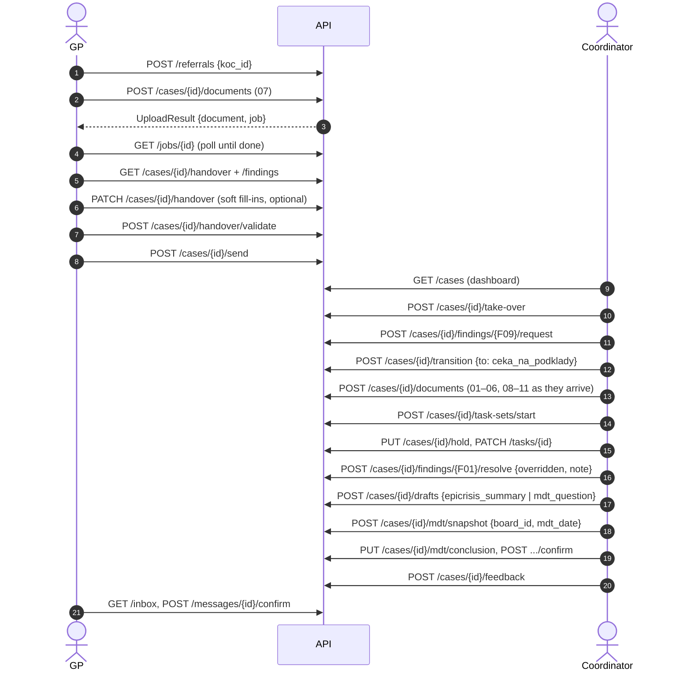

# API

The full MVP API is **defined** in code:
- **Endpoint stubs:** [`apps/api/src/onko_api/routes.py`](../apps/api/src/onko_api/routes.py)
- **Request bodies:** [`schemas.py`](../apps/api/src/onko_api/schemas.py)
- **Responses:** the contract models in [`packages/contracts`](../packages/contracts/src/onko_contracts)

Every endpoint already has its request and response shape in the OpenAPI spec ([`apps/web/openapi.json`](../apps/web/openapi.json)) and in the generated web client (`apps/web/src/client`). The frontend can build against it today.

- **Status `defined (501)`:** the endpoint returns `501 Not Implemented` until its slice ([slices.md](slices.md)) implements it.
- **Status `works (seeded)`:** the endpoint already serves the reference case from the in-memory repository.
- **Status `works`:** implemented by its slice.

67 operations in total. Things users need that no operation covers yet, not even as a 501 stub, are listed in [Not in the API yet](#not-in-the-api-yet).

**S0 web demo (Q-W6):** the standalone web simulates the eight S0 directory/identity and demo clock/reset operations, plus `/cases` for the existing provisional S1 queue, using MSW and these existing models. Contract tests check the implemented success responses and `HTTPValidationError` response shapes against the committed OpenAPI. This does not implement or change backend endpoints; the statuses below still describe the actual API. The simulation does not cover the full API or every undocumented backend coercion. `VITE_API_MODE=real` disables it without falling back on errors. See [web README](../apps/web/README.md).

**S4 frontend demo (Q-W14):** the web now simulates the coordinator case mutations, manual handover edits, finding resolutions/requests, tasks and task sets, personal deadline notifications and case audit against the existing contracts. Return-to-GP stores a `case_returned` message that the S3 referral screen shows; the full inbox stays S6. The S3 referral operations (create, handover edits, examinations, validate, send, inbox) are simulated the same way. These are frontend MSW operations only: the endpoint statuses below continue to describe the Python backend.

**S5 web (Q-W15):** the MDT tab runs against the real S5 endpoints. Its MSW mock mirrors the backend's S5 rules and its audit action names, so mock and real mode behave the same.

**S6 frontend demo (Q-W16):** the web simulates the six feedback operations (`sendFeedback`, `listInbox`, `confirmReceipt`, `listCaseReceipts`, `listCaseMessages`, `createPatientNotice`) with MSW and the existing models: the coordinator's *Komunikace* tab and the GP's inbox on their home page. The endpoint statuses below still describe the Python backend, which stays 501.

Live docs while the API runs: `http://localhost:8000/docs`.

## Conventions
- **JSON everywhere.** Uploads are `multipart/form-data` with one `file` field. PDFs and original files are binary responses.
- **Current user:** header `X-Actor-Id` on every call that changes something, or that depends on who is asking (the demo role switcher, Q-I11). Actors come from the demo directory [`data/demo/directory.json`](../data/demo/directory.json); the reference case uses `pl-reznicek` (GP) and `koordinator` (coordinator at KOC 2).
- **Ids** are strings. **Dates** are ISO `YYYY-MM-DD`, **datetimes** ISO 8601. Task owners and request recipients can be a person or an organisation id.
- **Time:** "now" is the app clock (`/demo/clock`), so the demo can play the 2.–27. 10. story in minutes.
- **Data language is Czech** (`message_cs`, notes, drafts). Only the UI is multilingual (Q-F20).
- **Slow AI work is asynchronous.** Uploads and drafts return a `Job` (`queued → running → done | failed`), and the UI polls `GET /jobs/{id}`. Results land on the case (handover, findings, document metadata) or on the job: `job.draft` (drafts), `job.answer` (ask the case), `job.result` (suggestions).
- **Errors:** `{"detail": "..."}` with these codes:

  | Code | Meaning |
  |---|---|
  | 400 | Bad input |
  | 403 | Wrong role, or not this case's people: writes to a case need its referring doctor or a **coordinator of the case's KOC** (`Actor.organization_id == Case.koc_id`). Coordinator-only actions (S4) accept only the latter |
  | 404 | Not found. Every `/cases/{case_id}/…` route answers `case not found` for an unknown case, lists included; `200 []` means the case exists and has nothing yet (API-7) |
  | 409 | Not allowed in the current state, e.g. a transition outside `ALLOWED_TRANSITIONS`, or an MDT snapshot while blockers remain |
  | 415 | Upload of a file type we cannot parse (supported: .docx, .pptx, .pdf) |
  | 422 | Validation (FastAPI default), or an uploaded file that cannot be read |
  | 501 | Not implemented yet |

- **Vector search (S8, Q-I19):** "ask the case" (`askCase`) is a `Job` of kind `ask_case`; its `CaseAnswer` (verbatim quotes as `Evidence`, or `found=false`) arrives in `job.answer`. MKN-10 candidates (`listCodeCandidates`) are AI proposals for a diagnosis without a code; the pick (`pickDiagnosisCode`) is stored as `origin=manual` and the suggestion is written to the audit log (Q-C11, Q-I21). An extraction quote not found verbatim becomes a `Finding` of kind `unverified_quote` whose evidence is the nearest chunk of that document.
- **Manual entries** (`PATCH /cases/{id}/handover`) produce `Sourced` values with `origin=manual` and `entered={by, at}`. AI values carry `origin=ai` and verbatim `evidence`. The contracts enforce both.
- **Audit:** every write that changes a case appends an `AuditEvent` (`listAudit`, append-only, PER-13): `referral_created`, `document_uploaded`, `document_updated`, `handover_field_updated`, `examination_added`, `handover_validated`, `referral_sent`, `reextraction_started`, `case_taken_over`, `case_updated`, `case_transitioned`, `case_returned`, `hold_set`, `hold_cleared`, `milestones_updated`, `finding_resolved`, `finding_requested`, `task_created`, `task_updated`, `task_set_started`, `mdt_snapshot_created`, `mdt_record_updated`, `mdt_conclusion_saved`, `mdt_conclusion_uploaded`, `mdt_conclusion_confirmed`. `detail` is Czech text; notes without a home on the models (`CaseTransition.note`, `RequestTaskCreate.note`) go there. Task sets and MDT board rosters belong to no case and are not audited; drafts change nothing and are not audited either.
- **Who is on the move** (`Case.on_move`, `next_step`, `next_due`) is recomputed after every task change, take-over, return and resend: the earliest ready task (owner, title, due); without one the coordinator, with no step; while the case is `vraceno_lekari` the referring doctor.
- **MDT (S5):** *Připravit podklad pro MDT* (`createMdtSnapshot`) freezes a copy of the live handover (`getHandover?snapshot=true`, `as_of` = MDT date) and builds the `MdtRecord`. It is 409 while blockers are unresolved, while a document is still being extracted, or when the handover quotes a document received after the MDT date (Q-F39). The record is edited only before the meeting; the conclusion until the feedback is sent, and an edit needs a new confirmation (Q-F34). Confirming writes the definitive diagnosis into the live handover as a manual value and sets `milestones.mdt_held`; findings are resolved explicitly (Q-F36). Drafts (`createDraft`) cover what the MDT receives and come back typed in `Job.draft` (`text`, `rows` or `fields`); `mdt_conclusion` is a non-AI prefill (Q-F37). PDFs follow the `MDT_zapis` / `MDT_zaver` layouts.
- **Storage:** app state is kept in IRIS, projected to FHIR only where needed (decision 16. 10.). Nothing in the API exposes FHIR directly; the one FHIR input is `createReferralFromBundle`, a referral Bundle uploaded as a file (S9, Q-I20).
- **MCP:** a read-only MCP server is mounted under `/mcp` (S10, Q-I23; `/api/mcp` in production). It is not part of the 67 REST operations or the OpenAPI spec. Its tools (`search_cases`, `get_case`, `get_time_to_treatment`, `case_overview`, `list_findings`, `get_handover`, `ask_case`) call the same services and return the same contract models as the read endpoints, with the same `X-Actor-Id` check; errors come back as MCP tool errors with the same `detail` text. `ask_case(case_id, question)` returns a `CaseAnswer` like `askCase`'s `job.answer`, but synchronously (a tool can't poll a job); without a model or an embedding model it is a tool error with the job's Czech reason.

## The flows through the API

## Coverage: brief and slides → API

Checked against [Zadani_ulohy](../data/vzp-structured/brief/Zadani_ulohy.md), the VZP slides and [demo-script.md](demo-script.md) before the freeze. Each requirement maps to the endpoints that satisfy it and the slice that builds them.

### The brief (Zadani_ulohy)

| Requirement | Endpoints | Slice |
|---|---|---|
| **Převzít** (take over): accept the GP's request and the documents they hand over | `createReferral` (or `createReferralFromBundle` from the GP's system, S9), `uploadDocument`, `updateHandoverField`, `validateHandover`, `sendReferral`, then `takeOverCase`; the GP's documents stay available as originals (`listDocuments`, `getDocumentFile`) | S1, S3, S4 |
| **Vyžádat a shromáždit** (request and collect): request missing reports from other facilities; all documents in one place | `requestFromFinding`, `createTask` (`kind=request_documents`), `uploadDocument` (+ `received_at`), `updateTask` (`result_document_id`), `listDocuments`, `getDocumentFile`, `documentText`, `updateDocument` | S1, S2, S4 |
| **Vytěžit** (extract): AI fills `Handover_obsah`, flags missing and conflicting values | `uploadDocument` → `Job` (`ingest_document`), `getJob`, `reextractCase`, `getHandover`, `listFindings`, `updateHandoverField`, `resolveFinding` | S2 |
| **Koordinovat** (coordinate): plan and track journey steps with date, place and status | `startTaskSet`, `createTask`, `updateTask`, `listTasks`, `listTaskSets` / `createTaskSet` / `updateTaskSet`, `setHold` / `clearHold`, `transitionCase`, `listNotifications` | S4 |
| **Připravit podklad pro MDT** (MDT input): add the KOC's examinations; only data available on 21. 10. | `uploadDocument` (08–11), `createDraft` (`epicrisis_summary`, `mdt_question`, `mdt_results`), `createMdtSnapshot` (frozen `as_of`), `updateMdtRecord`, `getMdtRecord`, `getMdtRecordPdf` | S5 |
| **Uzavřít smyčku** (close the loop): send the MDT result to the GP **and prove delivery** | `upsertMdtConclusion` / `uploadMdtConclusion`, `confirmMdtConclusion`, `sendFeedback`, `listInbox`, `confirmReceipt`, `listCaseReceipts` | S5, S6 |
| Deliverable: working demo of the whole journey | all of the above + `resetDemo`, `setDemoClock` | S0–S7 |
| Deliverable: MDT record per `MDT_zapis` | `getMdtRecord`, `getMdtRecordPdf`; `MdtRecord` covers every `MDT_zapis` field (date, patient name / insurer / phone / email / address / weight / height, referring doctor name / phone / email, members, diagnosis + MKN-10, comorbidities, results date / examination / result); sections 6–7 come from `MdtConclusion` | S5 |
| Deliverable: sending the MDT conclusion to the GP | `sendFeedback` → `listInbox` → `confirmReceipt` | S6 |
| Rule: only what was known on 21. 10. | Snapshot freeze in `createMdtSnapshot` + `received_at` on upload + `/demo/clock`; reports 12–13 uploaded afterwards don't change the record | S0, S5 |
| Rule: take data as written, mark what is missing | `Sourced` (`status`, `origin`, `evidence`, `entered`), `listFindings`; manual "Není k dispozici" via `updateHandoverField` | S2, S3 |

### The slides

| Slide | Requirement | Endpoints / fields | Slice |
|---|---|---|---|
| 4 | Time to treatment T1 + T2 + T3 | `getTimeToTreatment`, `updateMilestones`, `Case.milestones` | S1, S4 |
| 7 | Pick a KOC from the list | `listOrganizations?kind=koc` | S3 |
| 7 | GP's own details + patient details + epikríza + suspected diagnosis, no long form | `me`, AI prefill via `uploadDocument`, corrections via `updateHandoverField` | S3 |
| 7 | Coordinator gets everything in one step | `sendReferral` → `listCases` / `getCase` / `getHandover` | S3, S1 |
| 8 | Predefined structure, copy-ready parts, doctor validates | `Handover` schema, `validateHandover` | S2, S3 |
| 8 | Coordinator sees the validated handover + list of missing items | `getHandover` (`validated_by_referrer`), `listFindings` | S1 |
| 8 | Coordinator contacts the doctor through the app | `returnCase` (return the referral with a note → `case_returned` message in the GP's `listInbox`), then `sendReferral` (D-15). A general request/reply inbox is **Phase 2** (Q-F23); in the MVP other requests are request tasks | S3, S4 |
| 9 | Queue new / active / on hold | `listCases?queue=…&koc_id=…`, `Case.queue`, `setHold` | S1, S4 |
| 9 | Detail: context from the referral (structured + original) | `getHandover`, `getDocumentFile`, `documentText`, `Evidence.start/end` | S1 |
| 9 | Tasks with deadlines and **priority** | `Task.due`, `Task.priority`, `Case.priority`, `updateCase` | S4 |
| 9 | Every case shows state, deadline and who is on the move | `Case.state`, `next_step`, `next_due`, `on_move` | S1 |
| 10 | One-off task or a whole set for a diagnosis | `createTask`, `startTaskSet`, `listTaskSets?diagnosis_code=` | S4 |
| 10 | Ordering (what must come first) | `Task.depends_on`, `TaskUpdate.depends_on` | S4 |
| 10 | Notifications on deadlines | `listNotifications` (in-app, Q-F17) | S4 |
| 10 | Communication e-mail / SMS / chat | In the MVP only the simulated patient notice (`createPatientNotice`); **the rest is Phase 2** | S6 |
| 10 | The 8 case states (plus `koncept`, D-8, and `vraceno_lekari`, D-15) | `CaseState`, `transitionCase`, `takeOverCase`, `returnCase`, the state changes inside the snapshot / confirm / feedback / receipt endpoints | S4–S6 |
| 11 | Coordinator picks the case and uploads the MDT report | `uploadMdtConclusion` (or `upsertMdtConclusion`) | S5 |
| 11 | GP receives the report with the original context | `sendFeedback` (`Message.attachment_document_ids`), `listInbox` | S6 |
| 11 | Reviewing doctor informed automatically | **Deferred to Phase 2** (Q-F10) | — |
| 11 | Confirm the handover and close the case | `confirmReceipt` → `uzavreno`, `listCaseReceipts`, `listAudit` | S6 |
| 12 | Demo checklist (6 items) | covered by the rows above | — |

### Demo support (not in the brief, needed to run the demo)

| Need | Endpoints |
|---|---|
| The story runs 2.–27. 10. 2026; the demo runs in minutes | `getDemoClock` / `setDemoClock` (stamps, due/overdue, time to treatment), `received_at` on uploads |
| Run the demo again from step 1 | `resetDemo` (`empty` / `reference_at_mdt`) |
| Several KOCs and doctors | directory seed [`data/demo/directory.json`](../data/demo/directory.json): 5 KOCs with a coordinator each, 5 referring doctors, report specialists, 5 MDT boards, all insurers |

**Consciously deferred** (team decisions): in-app communication with the doctor beyond returning the referral (D-15) and email/SMS (Q-F23), the reviewing-doctor feed (Q-F10), repeated MDT rounds (Q-F8, still open), bonus AI task suggestions (`suggestTasks` is defined but optional).

## Not in the API yet

Needs with **no operation at all**, not even a 501 stub. Each one gets its operations and models through a contract PR first, then a new row in the tables below.

| # | Gap | Today | Owner |
|---|---|---|---|
| 1 | **Lab results:** add, correct or remove a lab panel or one of its values | No write operation. `LabPanel` already has `origin` and `entered` for manual entries, and `updateHandoverField` rejects `labs` (not a `Sourced` field) | S11 (Phase 2) |
| 2 | **Examinations:** correct or remove one (date, place, type, result text) | Add only (`addExamination`). A wrong date also moves the examination across the MDT cut-off | S11 (Phase 2) |
| 3 | **Remove a document** (wrong upload, duplicate) | No operation. The duplicate check on upload only warns (Q-I22) | S11 (Phase 2) |
| 4 | **Undo a manual entry** back to the AI value and its evidence | A manual value can be overwritten or marked "Není k dispozici", never reverted; `Sourced` keeps no history | S11 (Phase 2) |
| 5 | **Remove a task set** | `createTaskSet` / `updateTaskSet` only | S11 (Phase 2) |
| 6 | **Normalised lab values and performance status** (Q-C13) | `LabValue.value` and `performance_status` are plain strings | S2 |

Open design questions for S11: Q-F24–Q-F27 in [open-questions.md](open-questions.md).

## Endpoints

Generated from the spec. "Actor" means the endpoint takes `X-Actor-Id`. "Client fn" is the function name in `apps/web/src/client/sdk.gen.ts`.

### system

| Method | Path | Request | Response | Actor | Client fn | Status |
|---|---|---|---|---|---|---|
| `GET` | `/health` | — | `object` 200 |  | `health` | **works** (seeded) |

### demo

| Method | Path | Request | Response | Actor | Client fn | Status |
|---|---|---|---|---|---|---|
| `GET` | `/demo/clock` | — | `DemoClock` 200 |  | `getDemoClock` | **works** |
| `PUT` | `/demo/clock` | `DemoClockSet` | `DemoClock` 200 |  | `setDemoClock` | **works** |
| `POST` | `/demo/reset` | `DemoReset` | `list[Case]` 200 |  | `resetDemo` | **works** |

### directory

| Method | Path | Request | Response | Actor | Client fn | Status |
|---|---|---|---|---|---|---|
| `GET` | `/me` | — | `Actor` 200 | ✓ | `me` | **works** |
| `GET` | `/directory/organizations` | — · query `kind` | `list[Organization]` 200 |  | `listOrganizations` | **works** |
| `GET` | `/directory/actors` | — · query `role`, `organization_id` | `list[Actor]` 200 |  | `listActors` | **works** |
| `GET` | `/mdt-boards` | — | `list[MdtBoard]` 200 |  | `listMdtBoards` | **works** |
| `GET` | `/mdt-boards/{board_id}` | — | `MdtBoard` 200 |  | `getMdtBoard` | **works** |
| `PUT` | `/mdt-boards/{board_id}/members` | `MdtBoardMembersUpdate` | `MdtBoard` 200 | ✓ | `updateMdtBoardMembers` | **works** (S5) |

### referral

| Method | Path | Request | Response | Actor | Client fn | Status |
|---|---|---|---|---|---|---|
| `POST` | `/referrals` | `ReferralCreate` | `Case` 201 | ✓ | `createReferral` | **works** (S3) |
| `POST` | `/cases/{case_id}/send` | — | `Case` 200 | ✓ | `sendReferral` | **works** (S3) |
| `POST` | `/referrals/fhir` | file (multipart, FHIR `Bundle` JSON) + form `koc_id` | `Case` 201 | ✓ | `createReferralFromBundle` | **works** (S9) |

### documents

| Method | Path | Request | Response | Actor | Client fn | Status |
|---|---|---|---|---|---|---|
| `POST` | `/cases/{case_id}/documents` | file (multipart) | `UploadResult` 201 | ✓ | `uploadDocument` | **works** (S2) |
| `GET` | `/cases/{case_id}/documents` | — | `list[DocumentMeta]` 200 |  | `listDocuments` | **works** (seeded) |
| `PATCH` | `/documents/{document_id}` | `DocumentMetaUpdate` | `DocumentMeta` 200 | ✓ | `updateDocument` | **works** (S2) |
| `GET` | `/documents/{document_id}/file` | — | application/octet-stream 200 |  | `getDocumentFile` | **works** (S1) |
| `GET` | `/documents/{document_id}/text` | — | `object` 200 |  | `documentText` | **works** (seeded) |

### handover

| Method | Path | Request | Response | Actor | Client fn | Status |
|---|---|---|---|---|---|---|
| `PATCH` | `/cases/{case_id}/handover` | `HandoverFieldUpdate` | `Handover` 200 | ✓ | `updateHandoverField` | **works** (S3) |
| `GET` | `/cases/{case_id}/handover` | — · query `snapshot` | `Handover` 200 |  | `getHandover` | **works** (seeded) |
| `POST` | `/cases/{case_id}/handover/examinations` | `ExaminationCreate` | `Handover` 201 | ✓ | `addExamination` | **works** (S3) |
| `GET` | `/cases/{case_id}/handover/code-candidates` | — | `list[CodeCandidate]` 200 |  | `listCodeCandidates` | **works** (S8) |
| `POST` | `/cases/{case_id}/handover/diagnosis-code` | `DiagnosisCodePick` | `Handover` 200 | ✓ | `pickDiagnosisCode` | **works** (S8) |
| `POST` | `/cases/{case_id}/handover/validate` | — | `Handover` 200 | ✓ | `validateHandover` | **works** (S3) |

### jobs

| Method | Path | Request | Response | Actor | Client fn | Status |
|---|---|---|---|---|---|---|
| `GET` | `/jobs/{job_id}` | — | `Job` 200 |  | `getJob` | **works** (S2) |
| `GET` | `/cases/{case_id}/jobs` | — | `list[Job]` 200 |  | `listCaseJobs` | **works** (S2) |
| `POST` | `/cases/{case_id}/extract` | — | `Job` 202 | ✓ | `reextractCase` | **works** (S2) |
| `POST` | `/cases/{case_id}/drafts` | `DraftCreate` | `Job` 202 | ✓ | `createDraft` | **works** (S5) |
| `POST` | `/cases/{case_id}/suggestions/tasks` | — | `Job` 202 | ✓ | `suggestTasks` | defined (501) |
| `POST` | `/cases/{case_id}/ask` | `CaseAsk` | `Job` 202 | ✓ | `askCase` | **works** (S8) |

### cases

| Method | Path | Request | Response | Actor | Client fn | Status |
|---|---|---|---|---|---|---|
| `POST` | `/cases/{case_id}/take-over` | — | `Case` 200 | ✓ | `takeOverCase` | **works** (S4) |
| `PATCH` | `/cases/{case_id}` | `CaseUpdate` | `Case` 200 | ✓ | `updateCase` | **works** (S4) |
| `GET` | `/cases/{case_id}` | — | `Case` 200 |  | `getCase` | **works** (seeded) |
| `POST` | `/cases/{case_id}/transition` | `CaseTransition` | `Case` 200 | ✓ | `transitionCase` | **works** (S4) |
| `POST` | `/cases/{case_id}/return` | `CaseReturn` | `Case` 200 | ✓ | `returnCase` | **works** (S4) |
| `PUT` | `/cases/{case_id}/hold` | `HoldSet` | `Case` 200 | ✓ | `setHold` | **works** (S4) |
| `DELETE` | `/cases/{case_id}/hold` | — | `Case` 200 | ✓ | `clearHold` | **works** (S4) |
| `PATCH` | `/cases/{case_id}/milestones` | `MilestonesUpdate` | `Case` 200 | ✓ | `updateMilestones` | **works** (S4) |
| `GET` | `/cases/{case_id}/time-to-treatment` | — | `TimeToTreatment` 200 |  | `getTimeToTreatment` | **works** (S4) |
| `GET` | `/cases/{case_id}/audit` | — | `list[AuditEvent]` 200 |  | `listAudit` | **works** (S4) |
| `GET` | `/cases` | — · query `referring_doctor_id`, `koc_id`, `state`, `queue` | `list[Case]` 200 |  | `listCases` | **works** (seeded) |

### findings

| Method | Path | Request | Response | Actor | Client fn | Status |
|---|---|---|---|---|---|---|
| `POST` | `/cases/{case_id}/findings/{finding_id}/resolve` | `FindingResolve` | `Finding` 200 | ✓ | `resolveFinding` | **works** (S4) |
| `POST` | `/cases/{case_id}/findings/{finding_id}/request` | `RequestTaskCreate` | `Task` 201 | ✓ | `requestFromFinding` | **works** (S4) |
| `GET` | `/cases/{case_id}/findings` | — | `list[Finding]` 200 |  | `listFindings` | **works** (seeded) |

### tasks

| Method | Path | Request | Response | Actor | Client fn | Status |
|---|---|---|---|---|---|---|
| `POST` | `/cases/{case_id}/tasks` | `TaskCreate` | `Task` 201 | ✓ | `createTask` | **works** (S4) |
| `GET` | `/cases/{case_id}/tasks` | — | `list[Task]` 200 |  | `listTasks` | **works** (seeded) |
| `PATCH` | `/tasks/{task_id}` | `TaskUpdate` | `Task` 200 | ✓ | `updateTask` | **works** (S4) |
| `POST` | `/cases/{case_id}/task-sets/start` | `TaskSetStart` | `list[Task]` 201 | ✓ | `startTaskSet` | **works** (S4) |
| `GET` | `/task-sets` | — · query `diagnosis_code` | `list[TaskSet]` 200 |  | `listTaskSets` | **works** (S4) |
| `POST` | `/task-sets` | `TaskSetUpsert` | `TaskSet` 201 | ✓ | `createTaskSet` | **works** (S4) |
| `PUT` | `/task-sets/{task_set_id}` | `TaskSetUpsert` | `TaskSet` 200 | ✓ | `updateTaskSet` | **works** (S4) |
| `GET` | `/notifications` | — · query `within_days` | `list[DueNotice]` 200 | ✓ | `listNotifications` | **works** (S4) |

### mdt

| Method | Path | Request | Response | Actor | Client fn | Status |
|---|---|---|---|---|---|---|
| `POST` | `/cases/{case_id}/mdt/snapshot` | `MdtSnapshotCreate` | `MdtRecord` 201 | ✓ | `createMdtSnapshot` | **works** (S5) |
| `GET` | `/cases/{case_id}/mdt/record` | — | `MdtRecord` 200 |  | `getMdtRecord` | **works** (S5) |
| `PATCH` | `/cases/{case_id}/mdt/record` | `MdtRecordUpdate` | `MdtRecord` 200 | ✓ | `updateMdtRecord` | **works** (S5) |
| `GET` | `/cases/{case_id}/mdt/record.pdf` | — | application/pdf 200 |  | `getMdtRecordPdf` | **works** (S5) |
| `PUT` | `/cases/{case_id}/mdt/conclusion` | `MdtConclusionUpsert` | `MdtConclusion` 200 | ✓ | `upsertMdtConclusion` | **works** (S5) |
| `GET` | `/cases/{case_id}/mdt/conclusion` | — | `MdtConclusion` 200 |  | `getMdtConclusion` | **works** (S5) |
| `POST` | `/cases/{case_id}/mdt/conclusion/upload` | file (multipart) | `UploadResult` 201 | ✓ | `uploadMdtConclusion` | **works** (S5) |
| `POST` | `/cases/{case_id}/mdt/conclusion/confirm` | — | `MdtConclusion` 200 | ✓ | `confirmMdtConclusion` | **works** (S5) |
| `GET` | `/cases/{case_id}/mdt/conclusion.pdf` | — | application/pdf 200 |  | `getMdtConclusionPdf` | **works** (S5) |

### feedback

| Method | Path | Request | Response | Actor | Client fn | Status |
|---|---|---|---|---|---|---|
| `POST` | `/cases/{case_id}/feedback` | `FeedbackSend` | `Message` 201 | ✓ | `sendFeedback` | defined (501) |
| `POST` | `/cases/{case_id}/patient-notices` | `PatientNoticeCreate` | `Message` 201 | ✓ | `createPatientNotice` | defined (501) |
| `GET` | `/cases/{case_id}/messages` | — | `list[Message]` 200 |  | `listCaseMessages` | defined (501) |
| `GET` | `/cases/{case_id}/receipts` | — | `list[Receipt]` 200 |  | `listCaseReceipts` | defined (501) |
| `GET` | `/inbox` | — | `list[Message]` 200 | ✓ | `listInbox` | defined (501) |
| `POST` | `/messages/{message_id}/confirm` | — | `Receipt` 201 | ✓ | `confirmReceipt` | defined (501) |
