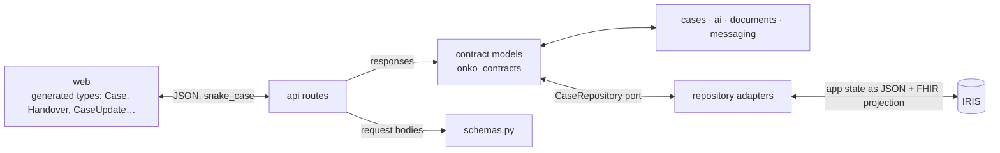

# Data conventions

Rules for the three shapes data takes in this repo: **domain models**, **API models**, and **persisted IRIS/FHIR**. Every rule has an ID so reviews (human or AI) can cite it. The [root AGENTS.md](../../AGENTS.md) makes these binding for AI agents.

The API itself (all 68 endpoints, request/response, status codes) is defined in [api.md](../api.md). This page doesn't repeat it; it says how to work with it. Decisions behind this page: Q-K1 to Q-K7 in [open-questions.md](../open-questions.md#k-code-conventions), plus Q-A1 to Q-A8 (API design).

## Three shapes, three owners

| Shape | Lives in | Used by | Never used by |
|---|---|---|---|
| **Domain model** (`Case`, `Handover`, `Finding`, …) | `onko_contracts` | every Python module; also the API's **responses** | n/a |
| **Request body** (`CaseUpdate`, `HoldSet`, `TaskCreate`, …) | `apps/api/src/onko_api/schemas.py` | API routes; the web app through the generated client | other Python modules |
| **App state in IRIS / FHIR projection** | `onko_repository` adapters | `onko_repository` only | everything else; the API only passes through an opaque FHIR download via the repository (Q-W18, api.md) |

## Domain models (`packages/contracts`)

| ID | Rule |
|---|---|
| DM-1 | Every domain model subclasses `onko_contracts.common.Model` (`extra="forbid"`), never `BaseModel` directly. |
| DM-2 | One file per topic (`cases.py`, `documents.py`, `findings.py`, `handover.py`, `messaging.py`, `mdt.py`, `jobs.py`, `directory.py`, `audit.py`, `search.py`, `common.py`). Every public name is exported from `onko_contracts/__init__.py` and listed in `__all__`. |
| DM-3 | Class names are plain English nouns with no suffix (`Case`, `Task`, `MdtRecord`). |
| DM-4 | Field names are English `snake_case`. Czech domain terms go in docstrings and `Field(description=…)`. **Data is Czech** (Q-A6): a field holding Czech text ends in `_cs` (`message_cs`), and notes and drafts are Czech. |
| DM-5 | Enums are `StrEnum`. Member names are English `UPPER_SNAKE`. **Values are stable wire and storage identifiers**: never rename or remove an existing value. New values are lowercase ASCII `snake_case`. |
| DM-6 | `datetime` for moments, `date` for calendar days, `str` for ids. Optional is `X \| None = None`. Lists default to `Field(default_factory=list)`. |
| DM-7 | Any field whose meaning isn't obvious from its name gets `Field(description=…)`. When it implements a decision, cite the ID (e.g. `(Q-F9)`). |
| DM-8 | Every handover value is `Sourced[T]` with the provenance the contract enforces (Q-A2): `origin=ai` needs verbatim `evidence`, `origin=manual` needs `entered`. A missing value is `status=MISSING, value=None`. Never a guess, never a placeholder (architecture principle 3, D-2). |
| DM-9 | The handover structure is fixed product schema. Any change to `handover.py` bumps `HANDOVER_SCHEMA_VERSION`. |
| DM-10 | Contracts hold data, validation and constants (e.g. `ALLOWED_TRANSITIONS`) only. No I/O, no business logic. Logic belongs in the module that owns it. |
| DM-11 | A type that never crosses a module boundary is not a contract. It goes in that module's `models.py` (see [implementation.md › MOD-4](implementation.md#module-layout)). |
| DM-12 | Domain models are treated as immutable: change one with `model_copy(update={…})`, never by assigning attributes. |
| DM-13 | A contract change is its own PR, reviewed by every stream. The same PR updates the reference JSONs and tests, `data-model.md` if the FHIR mapping changes, and regenerates the spec and client (API-6). |

## API models (`onko_contracts` + `schemas.py`)

| ID | Rule |
|---|---|
| APIM-1 | **Responses are the contract models** (`Case`, `Handover`, `list[Task]`, `Job`, …): every route returns exactly the response [api.md](../api.md) lists for it. The only plain objects are the two api.md defines that way (`health`, `documentText`). New endpoints return a contract model, never a `dict`, an ad-hoc model or a copy of a contract model. |
| APIM-2 | **Request bodies live in `apps/api/src/onko_api/schemas.py`** and subclass its `Body` base (`extra="forbid"`). Each body is named `<Noun><Action>`, as main defines them: `ReferralCreate`, `CaseUpdate`, `CaseTransition`, `HoldSet`, `TaskCreate`, `TaskSetUpsert`, `FindingResolve`. Bodies may reuse contract enums and models. |
| APIM-3 | **Use the models that exist.** Before adding an endpoint or a field, look in `onko_contracts` and `schemas.py`. Reuse an existing model rather than adding a near-duplicate. |
| APIM-4 | **Response models stay stable** (slices.md): a slice implements its stub without changing the response model. If one must change, change the contract first (DM-13), then regenerate the spec and client. |
| APIM-5 | The wire format follows api.md: JSON in `snake_case` (no aliases), string ids, ISO dates/datetimes, Czech data. Uploads are `multipart/form-data` with one `file` field. The current user comes from `X-Actor-Id`. Slow AI work returns a `Job`. |
| APIM-6 | Errors: `HTTPException(status, "message")` → `{"detail": "…"}` with the status codes in api.md (400, 403, 404, 409, 422, 501, 502, 503). There is no error model. |
| APIM-7 | After any route, request-body or contract change, regenerate and commit `apps/web/openapi.json` and `apps/web/src/client` (`uv run python scripts/export_openapi.py`, then `npm --prefix apps/web run gen:api`). `test_committed_openapi_spec_is_current` fails otherwise. |

Binary downloads use `Response` with an OpenAPI media type, as for original documents and PDFs.
The S9 FHIR download (Q-W18) declares `application/fhir+json` as a binary file; no FHIR resource
model or ad-hoc JSON response model is introduced in the app contracts.

## Persistence (`packages/repository`)

| ID | Rule |
|---|---|
| PER-1 | Only `onko_repository` talks to IRIS (SQL and FHIR REST). Every other module receives a `CaseRepository` (the port) and never imports an adapter. |
| PER-2 | The port speaks domain models only. SQL rows and FHIR JSON never leave the repository. |
| PER-3 | One adapter per backend in `adapters/` (`memory.py`, `iris.py`). `InMemoryRepository` is the behavioural reference, and every adapter passes the same tests. |
| PER-4 | **App state is stored in IRIS SQL tables generated from the contract models** (a typed column per field; the handover as one JSON document), and **projected to FHIR only where needed**: the showcase resources listed in slices.md S7 and the exchange resources in S9 (Q-A7, Q-I14, Q-I20). |
| PER-5 | [data-model.md](../data-model.md) is the source of truth for that FHIR projection. A newly projected domain model or field gets its row in the table in the same PR. Projected resources declare `meta.profile` with the CZ/EU profile from that table, or base R4 where the table says so (Q-I6, Q-I7). |
| PER-6 | Use the identifier systems listed in data-model.md verbatim (RC, CPOJ, KP, IČP, …). Add any new system to data-model.md first. |
| PER-7 | A missing value is never persisted as a placeholder. It is a `Finding`, as with ECOG: no fake `Observation`. |
| PER-8 | An AI-proposed value is projected with `Provenance` (agent = AI, with the evidence). A human validation or confirmation is its own `Provenance`. |
| PER-9 | The MDT snapshot (`snapshot=True`) is stored separately from the live handover and never overwritten by live updates. It only uses documents with `received_at <= as_of` (D-3). |
| PER-10 | Anything a dev writes to the shared IRIS namespace has an id prefixed with that dev's name (Q-I3). Demo data is unprefixed. |
| PER-11 | Non-FHIR SQL tables are listed under *Non-FHIR storage* in data-model.md. Table names are `snake_case` singular (`llm_call`, `doc_chunk`). |
| PER-12 | Connection details and secrets come only from `.env` through `IrisSettings` (`ONKO_` prefix, `SecretStr`). Never log them, put them in docs, or commit them (Q-I2). |
| PER-13 | Audit rows (`app_audit`) are append-only: never updated, and deleted only by the demo reset. Foreign keys hold in IRIS and in the in-memory fake alike: a reference to a missing case or document fails in both (Q-I26, PER-3). |
