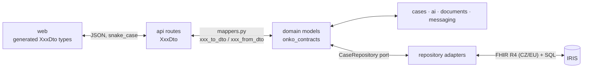

# Data conventions

Rules for the three shapes data takes in this repo: **domain models**, **API DTOs**, and **persisted FHIR/SQL**. Every rule has an ID so reviews (human or AI) can cite it. The [root AGENTS.md](../../AGENTS.md) makes these binding for AI agents.

Decisions behind this page: Q-A1 to Q-A10 in [open-questions.md](../open-questions.md#a-architecture-and-conventions).

## Three shapes, three owners

| Shape | Lives in | Used by | Never used by |
|---|---|---|---|
| **Domain model** (`Case`, `Handover`, …) | `onko_contracts` (top level) | every Python module | the web app, the HTTP boundary |
| **DTO** (`CaseDto`, `HandoverDto`, …) | `onko_contracts.dto` | `apps/api` routes and mappers; the web app through the generated client | any other module |
| **FHIR resource / IRIS SQL row** | `onko_repository` adapters | `onko_repository` only | everything else |

## Domain models (`packages/contracts`)

| ID | Rule |
|---|---|
| DM-1 | Every domain model subclasses `onko_contracts.common.Model` (`extra="forbid"`), never `BaseModel` directly. |
| DM-2 | One file per topic (`cases.py`, `documents.py`, `findings.py`, `handover.py`, `messaging.py`, `common.py`). Every public name is exported from `onko_contracts/__init__.py` and listed in `__all__`. |
| DM-3 | Class names are plain English nouns with no suffix (`Case`, `Task`, `Finding`). The `Dto` suffix is reserved for DTOs. |
| DM-4 | Field names are English `snake_case`. Czech domain terms go in docstrings and `Field(description=…)`. A field holding Czech user-facing text ends in `_cs` (`message_cs`). |
| DM-5 | Enums are `StrEnum`. Member names are English `UPPER_SNAKE`. **Values are stable wire and storage identifiers**: never rename or remove an existing value. New values are lowercase ASCII `snake_case`. |
| DM-6 | `datetime` for moments, `date` for calendar days, `str` for ids. Optional is `X \| None = None`. Lists default to `Field(default_factory=list)`. |
| DM-7 | Any field whose meaning isn't obvious from its name gets `Field(description=…)`. When it implements a decision, cite the ID (e.g. `(Q-F9)`). |
| DM-8 | Every AI-extracted handover value is `Sourced[T]` with `Evidence` (verbatim quote + document id). A missing value is `status=MISSING, value=None`. Never a guess, never a placeholder (architecture principle 3, D-2). |
| DM-9 | The handover structure is fixed product schema. Any change to `handover.py` bumps `HANDOVER_SCHEMA_VERSION`. |
| DM-10 | Contracts hold data, validation and constants (e.g. `ALLOWED_TRANSITIONS`) only. No I/O, no business logic. Logic belongs in the module that owns it. |
| DM-11 | A type that never crosses a module boundary is not a contract. It goes in that module's `models.py` (see [implementation.md › MOD-4](implementation.md#module-layout)). |
| DM-12 | Domain models are treated as immutable: change one with `model_copy(update={…})`, never by assigning attributes. |
| DM-13 | A contract change is its own PR, reviewed by every stream. The same PR updates the reference JSONs and tests, the matching DTO and mapper if the model is exposed, and `data-model.md` if the FHIR mapping changes. |

## API DTOs (`onko_contracts.dto`)

DTOs are the **only** shapes that cross the HTTP boundary to the web app.

| ID | Rule |
|---|---|
| DTO-1 | Every route's request body and response is a DTO from `onko_contracts.dto`, or a `list` of one. Routes never accept or return a domain model, a `dict`, or a bare primitive. Path and query parameters stay primitives. |
| DTO-2 | Naming: `<DomainModel>Dto` for a DTO that mirrors a domain model (`Case` → `CaseDto`, `OnHold` → `OnHoldDto`, `Sourced[T]` → `SourcedDto[T]`). A DTO with no domain counterpart is named after its purpose (`HealthDto`, `DocumentTextDto`). Request bodies are named after the action (`CreateCaseDto`, `PutOnHoldDto`). |
| DTO-3 | Every DTO subclasses `onko_contracts.dto.Dto` (`extra="forbid"`, `from_attributes=True`). |
| DTO-4 | **Mirror the domain:** same field names, same nesting, and every nested model gets its own DTO. Diverge only when a screen needs it (a derived value, a hidden field), and say why in the DTO's docstring. |
| DTO-5 | Domain enums are **reused** (`CaseDto.state: CaseState`). Enums and constants are the only domain names `onko_contracts.dto` may import. |
| DTO-6 | JSON is `snake_case`, the same as the Python field names. No aliases. |
| DTO-7 | **Response DTOs have no defaults.** Every field is required, and nullable fields are `X \| None` with no default. This makes every field non-optional in the generated TS types. Request DTOs may have defaults for optional input. |
| DTO-8 | `dto/` mirrors the domain files: `dto/cases.py` ↔ `cases.py`, and so on. Every DTO is exported from `onko_contracts/dto/__init__.py` and listed in `__all__`. |
| DTO-9 | Domain ↔ DTO mapping happens **only** in `apps/api/src/onko_api/mappers.py`. Domain → DTO is `<model>_to_dto(x) -> XxxDto`; DTO → domain is `<model>_from_dto(dto, …) -> Model`. A mirror DTO maps with `XxxDto.model_validate(x)`; anything renamed, derived or hidden is written out field by field. |
| DTO-10 | Every mapper is covered in `apps/api/tests/test_mappers.py`: mirror DTOs dump equal to their domain model on the reference case, and diverging DTOs get explicit asserts. |
| DTO-11 | Errors keep FastAPI's default: `HTTPException(status, "message")` → `{"detail": "…"}`. There is no error DTO. |
| DTO-12 | After any DTO or route change, regenerate and commit `apps/web/openapi.json` and `apps/web/src/client` (`uv run python scripts/export_openapi.py`, then `npm --prefix apps/web run gen:api`). `test_committed_openapi_spec_is_current` fails otherwise. |

## Persistence and FHIR mapping (`packages/repository`)

| ID | Rule |
|---|---|
| PER-1 | Only `onko_repository` talks to IRIS (FHIR REST and SQL). Every other module receives a `CaseRepository` (the port) and never imports an adapter. |
| PER-2 | The port speaks domain models only. FHIR JSON, SQL rows and DTOs never leave the repository. |
| PER-3 | One adapter per backend in `adapters/` (`memory.py`, `iris.py`). `InMemoryRepository` is the behavioural reference, and every adapter passes the same tests. |
| PER-4 | [data-model.md](../data-model.md) is the source of truth for the domain ↔ FHIR mapping. A new domain model or field that is persisted gets its row in that table in the same PR. |
| PER-5 | Resources declare `meta.profile` with the CZ/EU profile from that table, or base R4 where the table says so (Q-I6, Q-I7). |
| PER-6 | Use the identifier systems listed in data-model.md verbatim (RC, CPOJ, KP, IČP, …). Add any new system to data-model.md first. |
| PER-7 | A missing value is never persisted as a placeholder resource. It is a `Finding` (`DetectedIssue`), as with ECOG: no fake `Observation`. |
| PER-8 | An AI-proposed value is written with `Provenance` (agent = AI, with the evidence). A human validation or confirmation is written as its own `Provenance`. |
| PER-9 | The MDT snapshot (`snapshot=True`) is stored separately from the live handover and never overwritten by live updates. It only uses documents with `received_at <= as_of` (D-3). |
| PER-10 | Anything a dev writes to the shared IRIS namespace has an id prefixed with that dev's name (Q-I3). Demo data is unprefixed. |
| PER-11 | Non-FHIR SQL tables are listed under *Non-FHIR storage* in data-model.md. Table names are `snake_case` singular (`doc_chunk`, `llm_call`). |
| PER-12 | Connection details and secrets come only from `.env` through `IrisSettings` (`ONKO_` prefix, `SecretStr`). Never log them, put them in docs, or commit them (Q-I2). |
