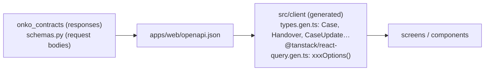

# Web conventions (`apps/web`)

How the React app is built. How it should look and behave is in [ui-ux.md](ui-ux.md), and the API models it consumes are in [data.md › API models](data.md#api-models-onko_contracts--schemaspy) and [api.md](../api.md). Every rule has an ID so reviews (human or AI) can cite it, and [apps/web/AGENTS.md](../../apps/web/AGENTS.md) makes them binding for AI agents.

Stack: React 19, TypeScript 6 (T-1), Vite, TanStack Query (Q-W4), a client generated by `@hey-api/openapi-ts` (T-2), Mantine (Q-W1), TanStack Router (Q-W2), and i18next + react-i18next (Q-W3).

## Talking to the API: existing models only



| ID | Rule |
|---|---|
| WEB-1 | **Every API call goes through the generated TanStack Query helpers** in `src/client/@tanstack/react-query.gen.ts`: `useQuery(listCasesOptions())`, `useMutation(xxxMutation())`. Never call `fetch`, axios or the raw SDK functions from a component. |
| WEB-2 | **API data is typed with the existing generated types** from `src/client/types.gen.ts`: responses are the contract models (`Case`, `Handover`, `Finding`, `Job`, …), request bodies the `schemas.py` models (`CaseUpdate`, `HoldSet`, `TaskCreate`, …). Before writing UI that shows or sends API data, read those types and the endpoint in [api.md](../api.md), and use what already exists. |
| WEB-3 | Never redeclare an API model's shape in the web app: no local `interface Case { … }`, no copied fields. Props that take API data use the generated type or a `Pick<Case, …>` of it. Never `as`-cast or `any` API data. |
| WEB-4 | If a screen needs data no API model has, change the backend: the contract first (DM-13, APIM-4), then regenerate (APIM-7). Never derive, fake or hard-code the missing data in a screen. **Demo exceptions Q-W6 / Q-W14:** MSW may serve explicitly labelled demo fixtures at the HTTP boundary, typed with existing generated models. Q-W14 explicitly extends this to the full S4 frontend and its mutable simulated workflow, Q-W16 to S6 (feedback, inbox, receipts, simulated patient notices), Q-W17 to S8 (questions, code candidates and manual picks), and Q-W18 to S9 (FHIR referral import and a fictional export file); business rules stay in MSW, never in screens. Components still use generated query helpers. Real mode never silently falls back to mock data. |
| WEB-5 | Never edit `src/client/**`: it is generated. Regenerate it with `npm run gen:api`. |
| WEB-6 | Business rules live in the backend modules. The web app does not recompute case states, allowed transitions, queue columns, next step, findings or time to treatment. It displays what the API returns. |
| WEB-19 | Slow AI work returns a `Job` (api.md). Poll it with `useQuery(getJobOptions(…))` and a `refetchInterval` that stops at `done` / `failed`, then invalidate the queries its result changes. Never poll with timers or effects. |
| WEB-20 | Calls that change something, or depend on who asks, send the `X-Actor-Id` header of the current role (api.md, Q-I11). |
| WEB-7 | Enum fields are compared against the generated string-literal unions (`c.queue === 'novy'`). Labels shown to users come from a label map (and later from i18n), not from the raw value. |

## React: components, no effects

| ID | Rule |
|---|---|
| WEB-8 | Build the UI from function components with typed props. One component per concern, composed in JSX. No class components. |
| WEB-9 | **Use Mantine components for everything it provides** (buttons, inputs, selects, dialogs, tables, cards, badges, layout, …), with its theme and styling APIs. Semantic structural elements such as `header`, `nav`, `form` and `div` remain appropriate. Don't rebuild equivalent controls or add another UI library. Icons come from `@tabler/icons-react` (Q-W13), never emoji or text glyphs. |
| WEB-10 | **No `useEffect`**, and no `useLayoutEffect` or `useInsertionEffect` either. Use the replacements in the table below. If you believe an effect is unavoidable, stop and ask. An exception needs a decision recorded in open-questions.md. |
| WEB-11 | Server state lives only in TanStack Query. Never copy query data into `useState`. Local UI state (an open dialog, a draft input) uses `useState` or `useReducer`. No global store without a recorded decision. |
| WEB-12 | After a mutation, invalidate the affected queries with the generated keys: `queryClient.invalidateQueries({ queryKey: listCasesQueryKey() })`. |
| WEB-13 | Every query renders all four states: pending, error, empty and success (UX-10). |

What to use instead of an effect:

| You want to… | Use |
|---|---|
| Load data from the API | `useQuery(xxxOptions(…))` (WEB-1) |
| Send data to the API | `useMutation(xxxMutation())` from an event handler or form submit |
| Compute something from props/state | Compute it during render (`useMemo` only if it's measurably expensive) |
| Reset state when an id changes | Give the component `key={id}` |
| React to a user action | The event handler (`onClick`, `onSubmit`, …) |
| Read an external store (window size, `localStorage`) | `useSyncExternalStore` |
| Touch a DOM node (focus, measure) | A ref callback |
| Sync with a non-React widget | Ask first (WEB-10) |

## Structure and naming

```
apps/web/src/
  main.tsx                 entry: client base URL, QueryClientProvider, render
  App.tsx                  router provider
  router.ts                code-based route definitions
  components/AppShell.tsx  shared header and layout
  mocks/                   HTTP demo boundary only (Q-W6)
  client/                  GENERATED: never edit (WEB-5)
  screens/                 one per screen in docs/product.md
    CoordinatorDashboard.tsx
    CaseDetail/            a folder once the screen has sub-components
      CaseDetail.tsx
      HandoverTab.tsx
  components/              shared components used by 2+ screens
```

| ID | Rule |
|---|---|
| WEB-14 | Screens map to [product.md › Screens](../product.md#screens-mvp), including the explicit S0 identity pages (Q-W9). A screen file is named after the screen in `PascalCase.tsx`. |
| WEB-15 | Components are `PascalCase.tsx` with a default export of the main component. A component moves to `components/` once a second screen uses it. |
| WEB-16 | Every UI string goes through i18next; initial language is Czech, English can be selected. **Data stays Czech** (Q-A6). Translate labels, not clinical content, names or source notes. Language changes update `html[lang]` and date formatting without resetting drafts. |
| WEB-17 | Styling uses Mantine's theme and style props. Global CSS is reserved for page background, structural header styling, focus, skip link and reduced motion. |
| WEB-18 | Before finishing: `npm --prefix apps/web run build` and `npm --prefix apps/web run lint` pass. |
| WEB-21 | Use the shared notification service in event handlers and operation callbacks, never render. Query/Mutation caches own HTTP failure notifications; job polling handles terminal `failed` data. Never install a second toast system or display raw `detail` / `Job.error`. See [notifications.md](../notifications.md). |
| WEB-22 | Pending actions use `ActionButton` / `ActionIconButton` and `pendingControlProps`. Keep button text, icons, size and colours stable; never use a button loading spinner or overlay. Keep interaction locks, business-disabled states and the shared floating progress status (with its spinner). Background refreshes preserve existing content. |

## S0 boundaries

- Session selection is ephemeral React UI state; the actor returned by `/me` remains in Query, never a copied object in state (Q-W8).
- An identity-dependent query passes `headers: { 'X-Actor-Id': id }` to the generated options so the header is included in its generated key. Global client headers alone do not partition Query caches.
- Mock mode is intentionally available in built demos (the Docker image builds `real`, Q-W6). It starts before React, preserves contract shapes and is isolated per tab. Reloading restores the reference scenario. Keep fixture data out of screens.
- The mock clock is the simulated server's responsibility and ticks from an anchor. Read it through Query with `refetchInterval`; no component timers. This demo-local computer timezone choice does not resolve backend Q-K8.
- Run `npm --prefix apps/web test` for S0 behavior changes. See the web README for demo and real-API modes.
