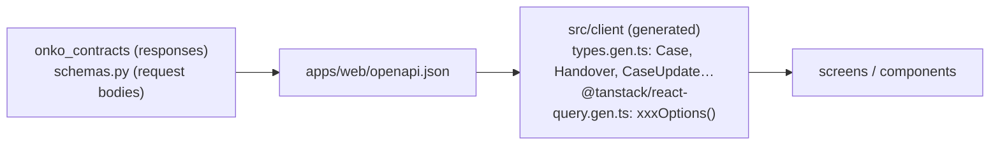

# Web conventions (`apps/web`)

How the React app is built. How it should look and behave is in [ui-ux.md](ui-ux.md), and the API models it consumes are in [data.md › API models](data.md#api-models-onko_contracts--schemaspy) and [api.md](../api.md). Every rule has an ID so reviews (human or AI) can cite it, and [apps/web/AGENTS.md](../../apps/web/AGENTS.md) makes them binding for AI agents.

Stack: React 19, TypeScript 6 (T-1), Vite, TanStack Query (Q-W4), and a client generated by `@hey-api/openapi-ts` (T-2). Still open: the UI component library (Q-W1), the router (Q-W2) and i18n (Q-W3).

## Talking to the API: existing models only



| ID | Rule |
|---|---|
| WEB-1 | **Every API call goes through the generated TanStack Query helpers** in `src/client/@tanstack/react-query.gen.ts`: `useQuery(listCasesOptions())`, `useMutation(xxxMutation())`. Never call `fetch`, axios or the raw SDK functions from a component. |
| WEB-2 | **API data is typed with the existing generated types** from `src/client/types.gen.ts`: responses are the contract models (`Case`, `Handover`, `Finding`, `Job`, …), request bodies the `schemas.py` models (`CaseUpdate`, `HoldSet`, `TaskCreate`, …). Before writing UI that shows or sends API data, read those types and the endpoint in [api.md](../api.md), and use what already exists. |
| WEB-3 | Never redeclare an API model's shape in the web app: no local `interface Case { … }`, no copied fields. Props that take API data use the generated type or a `Pick<Case, …>` of it. Never `as`-cast or `any` API data. |
| WEB-4 | If a screen needs data no API model has, change the backend: the contract first (DM-13, APIM-4), then regenerate (APIM-7). Never derive, fake or hard-code the missing data in the browser. |
| WEB-5 | Never edit `src/client/**`: it is generated. Regenerate it with `npm run gen:api`. |
| WEB-6 | Business rules live in the backend modules. The web app does not recompute case states, allowed transitions, queue columns, next step, findings or time to treatment. It displays what the API returns. |
| WEB-19 | Slow AI work returns a `Job` (api.md). Poll it with `useQuery(getJobOptions(…))` and a `refetchInterval` that stops at `done` / `failed`, then invalidate the queries its result changes. Never poll with timers or effects. |
| WEB-20 | Calls that change something, or depend on who asks, send the `X-Actor-Id` header of the current role (api.md, Q-I11). |
| WEB-7 | Enum fields are compared against the generated string-literal unions (`c.queue === 'novy'`). Labels shown to users come from a label map (and later from i18n), not from the raw value. |

## React: components, no effects

| ID | Rule |
|---|---|
| WEB-8 | Build the UI from function components with typed props. One component per concern, composed in JSX. No class components. |
| WEB-9 | **Use the UI library's components for everything it provides** (buttons, inputs, selects, dialogs, tables, tabs, cards, badges, layout, toasts, …). Never hand-roll an equivalent or restyle raw HTML to imitate one. Until the library is chosen (Q-W1), use plain semantic HTML elements and **don't add any UI library** without recording the decision in open-questions.md. |
| WEB-10 | **No `useEffect`**, and no `useLayoutEffect` or `useInsertionEffect` either. Use the replacements in the table below. If you believe an effect is unavoidable, stop and ask. An exception needs a decision recorded in open-questions.md. |
| WEB-11 | Server state lives only in TanStack Query. Never copy query data into `useState`. Local UI state (an open dialog, a draft input) uses `useState` or `useReducer`. No global store without a recorded decision. |
| WEB-12 | After a mutation, invalidate the affected queries with the generated keys: `queryClient.invalidateQueries({ queryKey: listCasesQueryKey() })`. |
| WEB-13 | Every query renders all four states: pending, error, empty and success (UX-10). |

What to use instead of an effect:

| You want to… | Use |
|---|---|
| Load data from the API | `useQuery(xxxOptions(…))` (WEB-1) |
| Send data to the API | `useMutation(xxxMutation())` from an event handler or form submit |
| Compute something from props/state | Compute it during render (`useMemo` only if it's measurably expensive) |
| Reset state when an id changes | Give the component `key={id}` |
| React to a user action | The event handler (`onClick`, `onSubmit`, …) |
| Read an external store (window size, `localStorage`) | `useSyncExternalStore` |
| Touch a DOM node (focus, measure) | A ref callback |
| Sync with a non-React widget | Ask first (WEB-10) |

## Structure and naming

```
apps/web/src/
  main.tsx                 entry: client base URL, QueryClientProvider, render
  App.tsx                  app shell (routing once Q-W2 is decided)
  client/                  GENERATED: never edit (WEB-5)
  screens/                 one per screen in docs/product.md
    CoordinatorDashboard.tsx
    CaseDetail/            a folder once the screen has sub-components
      CaseDetail.tsx
      HandoverTab.tsx
  components/              shared components used by 2+ screens
```

| ID | Rule |
|---|---|
| WEB-14 | Screens map 1:1 to the screens in [product.md › Screens](../product.md#screens-mvp). A screen file is named after the screen in `PascalCase.tsx`. |
| WEB-15 | Components are `PascalCase.tsx` with a default export of the main component. A component moves to `components/` once a second screen uses it. |
| WEB-16 | The UI is Czech + English (Q-F20); **data stays Czech** (Q-A6), so findings, notes and drafts are shown as they come. Until the i18n library is chosen (Q-W3), UI text is Czech, using the terms from product.md. Once it's chosen, every UI string goes through it. |
| WEB-17 | Until the UI library lands, inline `style` is allowed only for placeholder layout. After that, styling goes through the library's theming. |
| WEB-18 | Before finishing: `npm --prefix apps/web run build` and `npm --prefix apps/web run lint` pass. |
