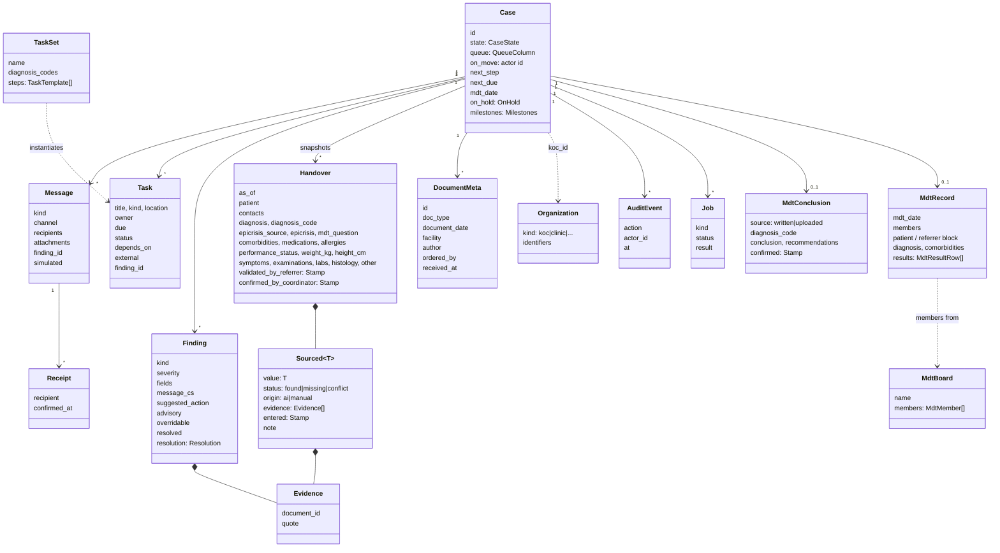

# Data model

- **Domain models:** [`packages/contracts`](../packages/contracts/src/onko_contracts), used by every module and the API.
- **Persistence and interop:** FHIR R4 (4.0.1) on the IRIS FHIR server, profiled with **HL7 Europe** and **CZ Core** where profiles exist, base R4 + extensions elsewhere.
- Only the `repository` module maps between the two.

## Domain (contracts)

How the MDT snapshot works:
- `Handover.as_of` is set when the case moves to *Připraveno k MDT*.
- The snapshot only uses documents with `received_at <= as_of`.
- The live handover keeps updating; the snapshot stays frozen.

## FHIR R4 mapping

Package ids, versions, profile names and identifier systems below were **checked against packages.fhir.org and the package contents on 16. 10. 2026**. "base R4" means no CZ/EU profile exists for that resource in these packages.

| Domain | FHIR resource | Profile (package) |
|---|---|---|
| Patient details | `Patient` | `cz-patient-core` (cz.core). Identifier slices: **RC** rodné číslo, system `https://ncez.mzcr.cz/fhir/sid/rcis`; **CPOJ** číslo pojištěnce, system `https://ncez.mzcr.cz/fhir/sid/cpoj`; also RID, OP (ID card), PAS |
| Insurer (code 211 = ZPMV in the reference case) | `Coverage` → payor `Organization` | `cz-coverage` (cz.core). Insurer org identifier slice **KP**, system `https://ncez.mzcr.cz/fhir/sid/kp` (presumably *kód pojišťovny*; the profile gives no description, so confirm) |
| Contact person (daughter) | `RelatedPerson` | `cz-relatedPerson-core` (cz.core) |
| Doctors, coordinator, MDT members, authors | `Practitioner`, `PractitionerRole` | `cz-practitioner-core`, `cz-practitionerrole-core` (cz.core); identifier systems `…/sid/krzp`, `…/sid/clk` exist in cz.core |
| Facilities (KOC 1, KOC 2, labs, clinics, GP) | `Organization`, `Location` | `cz-organization-core`, `cz-location-core` (cz.core). Identifier slices KRPZS, IČO, IČZ, **IČP** (`https://ncez.mzcr.cz/fhir/sid/icp`; the GP's IČP 72045318 is in report 07), KP |
| Case | `EpisodeOfCare` + `CarePlan` | `carePlan-cz-core` (cz.core); EpisodeOfCare base R4 + extensions for the case states (the brief's 8 plus `koncept` and `vraceno_lekari`), the on-hold flag and the time-to-treatment milestones |
| Referral (request to take over) | `ServiceRequest` | base R4 (cz.lab/cz.img only have lab/imaging order profiles). Also accepted **in** as a FHIR `Bundle` (S9, see *Referral in*) |
| Each uploaded report | `DocumentReference` + `Binary` | base R4 (cz.core has only attachment/logo/presented-form helpers) |
| Labs incl. tumour markers | `DiagnosticReport` + `Observation` | `diagnosticReport-cz-lab`, `observation-resultlab-cz-lab` (cz.lab 1.0.0, built on eu.laboratory 2.0.0) |
| Imaging (UZ, CT, RTG) | `DiagnosticReport`, `ImagingStudy` | `cz-diagnostic-report`, `cz-study-imaging` (cz.img 1.0.0, built on eu.imaging 1.0.0-ballot) |
| Biopsy (EUS-FNB) | `Procedure` | base R4 (`cz-procedure-imaging` in cz.img is imaging-specific) |
| Histology | `DiagnosticReport` + `Observation` | `diagnosticReport-cz-core`, `medicalTestResult-cz-core` (cz.core); no pathology-specific CZ profile |
| Diagnoses, comorbidities | `Condition` | `condition-cz-core` (cz.core); `verificationStatus` provisional → confirmed |
| Medication (FA) | `MedicationStatement` | `medicationStatement-cz-core` (cz.core) |
| Allergies (AA) | `AllergyIntolerance` | `allergyIntolerance-cz-core` (cz.core) |
| Weight, height | `Observation` | `cz-bodyweight`, `cz-bodyheight` (only in cz.img), else base R4 vital signs |
| ECOG / Karnofsky | `Observation` | base R4. A **missing value is a Finding, never a fake Observation** |
| Handover, MDT record, MDT conclusion | `Composition` + rendered `DocumentReference` (PDF). The sent MDT conclusion is also a document `Bundle` (`Composition` first, only the resources it references, unique `identifier` + timestamp, never changed) indexed by a `DocumentReference` with the Bundle and the PDF as attachments (S9, Q-I20) | `composition-cz-core` (cz.core) |
| AI evidence + human validation | `Provenance` | `cz-provenance` (cz.core) |
| Findings (gaps/conflicts) | `DetectedIssue` | base R4 |
| Journey steps (incl. request tasks) / task sets | `Task` / `PlanDefinition` | base R4. `Task` is projected (S9): requester = the KOC, owner = whoever is on the move (Q-I20) |
| MDT meeting | `Appointment`, `Encounter` | `appointment-cz-core`, `encounter-cz-core` (cz.core) |
| MDT result delivery, returned referrals (`case_returned`), receipts, patient notices (simulated) | `Communication` | base R4. `CommunicationRequest` for request/reply flows is Phase 2 (Q-F23) |
| Consent to share with the daughter | `Consent` | base R4 |
| Audit | `AuditEvent` | base R4, projected from `app_audit` (S9, Q-I26) |

### Referral in (S9, Q-I20, Q-I21)
`POST /referrals/fhir` takes a referral as a FHIR R4 `Bundle` (any `type`) uploaded as a file, with the KOC as a form field and the GP as `X-Actor-Id`. The case arrives **sent** (`odeslano`, queue Nový, `referred_at` = now) with no `validated_by_referrer` stamp: the GP never validated it in the app.
- **Documents:** every attachment of `DocumentReference.content` and `DiagnosticReport.presentedForm`, inline (`data`) or as a `Binary` inside the Bundle (its `fullUrl` or `Binary/{id}`), becomes a case document (`received_at` = now) and goes through extraction like an upload (S2). External URLs are never fetched. Supported types are those of uploads (.docx, .pptx, .pdf; by `contentType`, else the title's extension).
- **Structured resources** (`Patient`, `Condition`, `Observation`, …) are **not mapped** until Q-I21 adds an origin for values from another system; the handover holds only AI values with verbatim evidence from the attached documents.
- Nothing is saved when the Bundle or any attachment can't be read (422), a type is unsupported (415) or there is no document (400).

### Packages (as published on packages.fhir.org)

| Package | Version | Notes |
|---|---|---|
| `hl7.fhir.r4.core` | 4.0.1 | |
| `hl7.fhir.cz.core` | 1.0.0 | depends on eu.base 2.0.0, eu.laboratory 2.0.0, eu.extensions.r4 1.3.0, eu.mpd 1.0.0, **cz.terminology 0.3.0** |
| `hl7.fhir.cz.lab` | 1.0.0 | depends on cz.core 1.0.0, eu.laboratory 2.0.0, but **eu.base 2.0.0-ballot** |
| `hl7.fhir.cz.img` | 1.0.0 | depends on eu.imaging 1.0.0-ballot, fhir.dicom |
| `hl7.fhir.eu.base` | 2.0.1 | EU base + core |
| `hl7.fhir.eu.laboratory` | 2.0.0 | |
| `hl7.fhir.eu.extensions.r4` | 1.3.1 | the plain `hl7.fhir.eu.extensions` 1.x is R5, don't use it |
| `hl7.fhir.eu.eps` | 1.0.0-ballot only | Patient Summary, for a later export |
| `hl7.fhir.eu.hdr` | 0.1.0-ballot only | Hospital Discharge Report; too early to depend on |
| `hl7.fhir.cz.terminology` | **0.2.0 only** | cz.core and cz.lab require 0.3.0, which is not on the registry |

### How the projection is written (S7, S9)
- `IrisRepository` pushes the projection on every save, as one FHIR transaction (`PUT` by id): `save_document` → `DocumentReference` + `Binary` (Q-I10; the parsed text when the original bytes are missing); `save_handover` → `Patient`, `Condition`, `Observation`, `DiagnosticReport`, `Composition`, `Provenance`; `save_task` → `Task`; `save_audit` → `AuditEvent`; `save_mdt_conclusion` with a confirmed conclusion → the MDT conclusion document `Bundle` + its `DocumentReference` (S9, Q-I20). Findings, cases and messages are not projected.
- **`Task`** (S9): id `task-{task}`; status `planned` → `requested`, `booked` → `accepted`, `done` → `completed`, `cancelled` → `cancelled`; `intent=order`; priority `normal` → `routine`, `high` → `urgent`, `urgent` → `asap`; `requester` = the case's KOC, `owner` = `Task.owner` (both by name from the directory, as `display`); `restriction.period.end` = due; `for` = the case's `Patient` once a handover has been projected; the result document as `output` (`DocumentReference`).
- **`AuditEvent`** (S9): id `audit-{event}`, type DICOM `110110` *Patient Record*, the app's `action` as `subtype`, `recorded` = `at`, the actor as the requesting `agent`, the case's `Patient` as `entity` (with `detail` as its description).
- **MDT conclusion** (S9, Q-I20): built when a **confirmed** conclusion is saved (confirmation is required to send it). A FHIR **document `Bundle`** (`Bundle/{case}-mdt-conclusion-{confirmed.at}`): `identifier` `urn:ietf:rfc:3986` + a `urn:uuid` derived from the case and the confirmation time, `timestamp` = `confirmed.at`, `fullUrl`s and references as `urn:uuid`. Entries: the `Composition` first (*Závěr MDT*, `final`, sections Diagnóza / Klinické zhodnocení / Závěr / Doporučení), then only what it references: the `Patient` and the diagnosis `Condition`, now `confirmed` with the definitive MKN-10 code (Q-C9). A re-confirmed (corrected) conclusion gets a new id and identifier; an assembled Bundle is never changed. A `DocumentReference` with the same id indexes it: attachment 1 is the Bundle (`application/fhir+json`), attachment 2 the PDF: the uploaded report's `Binary` (source `uploaded`); the rendered PDF of a written conclusion joins when S5 renders it.
- FHIR ids derive from the app ids: `{case}-patient`, `{case}-dx`, `{case}-lab-1`, `{case}-handover`, `doc-{document}`. The MDT snapshot gets its own `{case}-mdt-…` resources (PER-9), sharing the case's `Patient`.
- A failed projection never loses the app-state save. Every FHIR write goes through the **outbox** (S9, D-14): the transaction `Bundle` is stored in `fhir_outbox` in the same IRIS SQL transaction as the app-state save, then sent right after the commit. A write that fails stays in the outbox and a background thread retries it every 10 s. Writes are sent **in order**, oldest first, and a failure stops the round, so an older state never overwrites a newer one. Pending writes are visible in `/health` (`fhir_pending`). Without `ONKO_FHIR_BASE_URL` nothing is queued.
- **MKN-10** is coded with `http://hl7.org/fhir/sid/icd-10`: cz.core 1.0.0 defines no MKN-10 system. The diagnosis `Condition` stays `provisional` (Q-C9).
- Body weight / height use the base R4 vital-signs profiles with LOINC `29463-7` / `8302-2`. Performance status is an `Observation` only when found (PER-7), without a LOINC code; once the contract carries scale + score (Q-C13), the score is its value.
- Lab results: today the projection parses the number itself when it can (`valueQuantity` with the printed unit, no UCUM code), else `valueString`. With Q-C13 the parsing moves into extraction: `valueQuantity` gets the normalized number, the comparator and the UCUM unit (`http://unitsofmeasure.org`); a value that couldn't be normalized stays a `valueString`.
- **Evidence:** each verbatim quote is a `Provenance.entity` (`role=source`) whose `what` references the source `DocumentReference` and carries the quote as `display` (PER-8). Manual values get an `author` Provenance with `entered.by/at`; `validated_by_referrer` / `confirmed_by_coordinator` get a `verifier` Provenance on the `Composition`.
- Naive datetimes are sent as Europe/Prague local time (D-13).

Two dependency problems with these packages. Decision (Q-I6, Q-I7): try loading them into IRIS; if that fails, declare `meta.profile` without server-side validation, and validate in tests/CI where feasible. Where the packages load, the opt-in IRIS tests validate every projected resource with the server's `$validate` (Q-I25).
- `hl7.fhir.cz.terminology` 0.3.0 is missing from the registry.
- `cz.lab` pins `hl7.fhir.eu.base` 2.0.0-ballot, while `cz.core` pins 2.0.0.

## Non-FHIR storage (IRIS SQL)

**App state** (Q-A7, PER-4, Q-I14): relational tables in schema `onko` (`ONKO_IRIS_SCHEMA`), namespace from the connection string, owned by `IrisRepository`. The columns are **generated from the contract models** (`adapters/iris_tables.py`):
- scalar fields become typed columns (`VARCHAR`, `DATE`, `TIMESTAMP`, `BIT`, `BIGINT`, `DOUBLE`; ids and enum values compare case-sensitively, `%EXACT`);
- nested models are flattened into `<field>__<subfield>` columns, plus `<field>__present` when the nested model is optional (`on_hold`, `resolution`);
- lists and dicts are JSON text columns (`depends_on`, `recipient_ids`, `evidence`, …).

Tables and columns missing on start are created (`ALTER TABLE … ADD COLUMN`), so a contract that gains a field needs no migration; a column added later reads back as the field's default for old rows. Column names are quoted (`"state"`, `"date"`).

| Table | Model | Key | Indexed | Extra columns |
|---|---|---|---|---|
| `app_organization` | `Organization` | `id` | `kind` | |
| `app_actor` | `Actor` | `id` | `role`, `organization_id` | |
| `app_mdt_board` | `MdtBoard` | `id` | | |
| `app_case` | `Case` | `id` | `koc_id`, `referring_doctor_id`, `state`, `queue` | |
| `app_document` | `DocumentMeta` | `id` | `case_id` | `doc_text` (parsed text, stream), `doc_data` (original bytes, stream) |
| `app_finding` | `Finding` | `case_id`, `id` | | `case_id`, `seq` (order) |
| `app_task` | `Task` | `id` | `case_id`, `owner`, `due` | |
| `app_message` | `Message` | `id` | `case_id` | |
| `app_receipt` | `Receipt` | `message_id`, `recipient_id` | | |
| `app_job` | `Job` | `id` | `case_id` | |
| `app_handover` | `Handover` | `case_id`, `is_snapshot` | | `body`: the handover as **one JSON document** (live and the frozen MDT snapshot, PER-9) |
| `app_audit` | `AuditEvent` | `id` | `case_id` | append-only (PER-13); foreign key `case_id` → `app_case` |
| `app_mdt_conclusion` | `MdtConclusion` | `case_id` | | foreign key `case_id` → `app_case` |
| `doc_chunk` | `DocChunk` | `id` (`{document_id}-{ord}`) | `case_id`, `document_id` | `embedding VECTOR(DOUBLE, n)`, `n` = `ONKO_EMBED_DIM` (Q-M7); foreign keys `case_id` → `app_case`, `document_id` → `app_document`; a document's chunks are replaced when it is indexed again (S8, Q-I19). Ranked by `VECTOR_COSINE` in an exact scan filtered by `case_id` (and `document_id` for an unverified-quote flag), no HNSW index |
| `mkn10_code` | `CodeCandidate` | `code` | | `embedding VECTOR(DOUBLE, n)`: the MKN-10 code list (Q-C12) embedded by its Czech name, loaded by `scripts/load_mkn10.py`, ranked by `VECTOR_COSINE` against the diagnosis text (S8, Q-C11). Reference data: the demo reset keeps it |
| `fhir_outbox` | (none) | `id` | | `case_id`, `bundle` (the transaction `Bundle` as JSON, stream), `attempts`, `last_error`; sent in insertion order, a row is deleted once sent (S9, D-14) |

The handover is the one document: 26 `Sourced` values with evidence, read and written whole. It is stored as a plain string, so IRIS SQL can query inside it with `JSON_TABLE`; its clinical content is what the FHIR projection carries.

A new port method that stores a new model adds its table here (PER-11). The two vector tables exist only with `ONKO_EMBED_DIM` set; they are not projected to FHIR.

**Planned schema changes (Q-I26)**, all plain IRIS SQL:
- `app_message_recipient(message_id, recipient_id)`, indexed on `recipient_id`, written in the same save as `app_message` (S6). Keyed like `app_receipt`.
- Foreign keys: `case_id` in `app_document`, `app_finding`, `app_task`, `app_message`, `app_handover`, `doc_chunk` → `app_case` (`app_audit` and `app_mdt_conclusion` have theirs since S9; `fhir_outbox.case_id` stays unconstrained, a document can be saved before its case); `document_id` in `doc_chunk` → `app_document` (S7). `clear()` deletes child tables first.
- Bitmap indexes instead of normal ones on `state`, `queue` (`app_case`), `kind` (`app_organization`), `role` (`app_actor`), if the tables keep IRIS's integer row ID (Q-I27).

- Duplicate uploads (Q-I22): a SHA-256 of the original bytes on `app_document`, compared on upload; near copies are compared on the parsed text. Planned with S2.
- `llm_call(id, step, model, prompt_hash, tokens_in, tokens_out, latency_ms, ok)`: bench and usage tracking (no limits, Q-M3).
