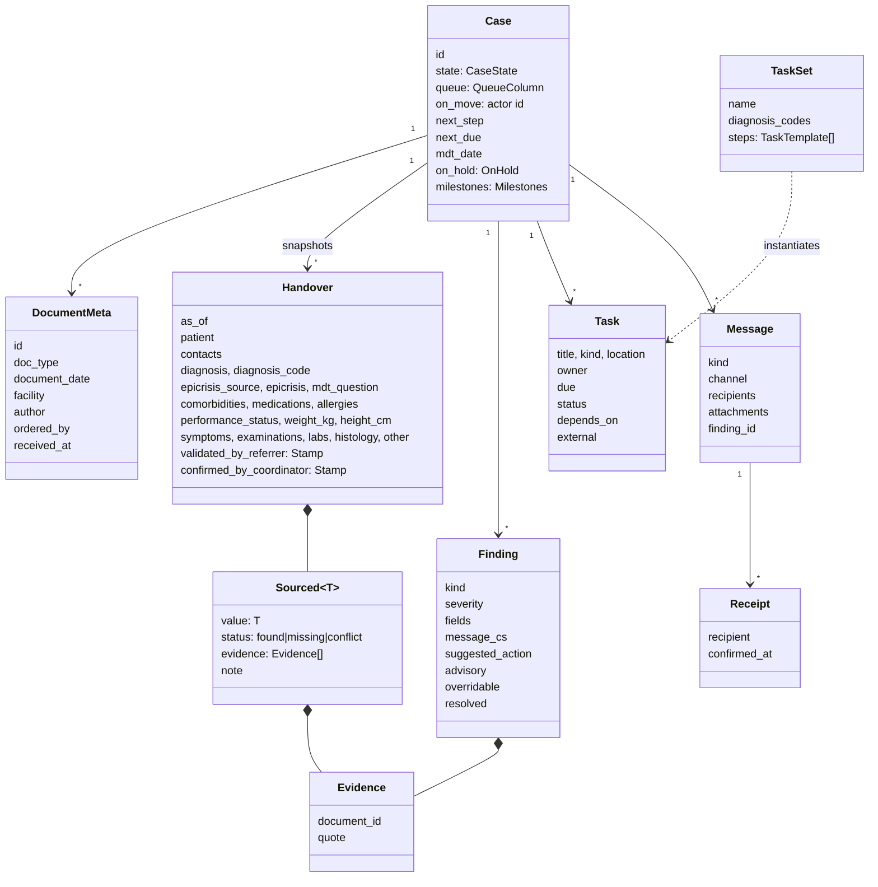

# Data model

- **Domain models:** [`packages/contracts`](../packages/contracts/src/onko_contracts), used by every module and the API.
- **Persistence and interop:** FHIR R4 (4.0.1) on the IRIS FHIR server, profiled with **HL7 Europe** and **CZ Core** where profiles exist, base R4 + extensions elsewhere.
- Only the `repository` module maps between the two.

## Domain (contracts)

How the MDT snapshot works:
- `Handover.as_of` is set when the case moves to *Připraveno k MDT*.
- The snapshot only uses documents with `received_at <= as_of`.
- The live handover keeps updating; the snapshot stays frozen.

## FHIR R4 mapping

Package ids, versions, profile names and identifier systems below were **checked against packages.fhir.org and the package contents on 16. 10. 2026**. "base R4" means no CZ/EU profile exists for that resource in these packages.

| Domain | FHIR resource | Profile (package) |
|---|---|---|
| Patient details | `Patient` | `cz-patient-core` (cz.core). Identifier slices: **RC** rodné číslo, system `https://ncez.mzcr.cz/fhir/sid/rcis`; **CPOJ** číslo pojištěnce, system `https://ncez.mzcr.cz/fhir/sid/cpoj`; also RID, OP (ID card), PAS |
| Insurer (code 211 = ZPMV in the reference case) | `Coverage` → payor `Organization` | `cz-coverage` (cz.core). Insurer org identifier slice **KP**, system `https://ncez.mzcr.cz/fhir/sid/kp` (presumably *kód pojišťovny*; the profile gives no description, so confirm) |
| Contact person (daughter) | `RelatedPerson` | `cz-relatedPerson-core` (cz.core) |
| Doctors, coordinator, MDT members, authors | `Practitioner`, `PractitionerRole` | `cz-practitioner-core`, `cz-practitionerrole-core` (cz.core); identifier systems `…/sid/krzp`, `…/sid/clk` exist in cz.core |
| Facilities (KOC 1, KOC 2, labs, clinics, GP) | `Organization`, `Location` | `cz-organization-core`, `cz-location-core` (cz.core). Identifier slices KRPZS, IČO, IČZ, **IČP** (`https://ncez.mzcr.cz/fhir/sid/icp`; the GP's IČP 72045318 is in report 07), KP |
| Case | `EpisodeOfCare` + `CarePlan` | `carePlan-cz-core` (cz.core); EpisodeOfCare base R4 + extension for the 8 states |
| Referral (request to take over) | `ServiceRequest` | base R4 (cz.lab/cz.img only have lab/imaging order profiles) |
| Each uploaded report | `DocumentReference` + `Binary` | base R4 (cz.core has only attachment/logo/presented-form helpers) |
| Labs incl. tumour markers | `DiagnosticReport` + `Observation` | `diagnosticReport-cz-lab`, `observation-resultlab-cz-lab` (cz.lab 1.0.0, built on eu.laboratory 2.0.0) |
| Imaging (UZ, CT, RTG) | `DiagnosticReport`, `ImagingStudy` | `cz-diagnostic-report`, `cz-study-imaging` (cz.img 1.0.0, built on eu.imaging 1.0.0-ballot) |
| Biopsy (EUS-FNB) | `Procedure` | base R4 (`cz-procedure-imaging` in cz.img is imaging-specific) |
| Histology | `DiagnosticReport` + `Observation` | `diagnosticReport-cz-core`, `medicalTestResult-cz-core` (cz.core); no pathology-specific CZ profile |
| Diagnoses, comorbidities | `Condition` | `condition-cz-core` (cz.core); `verificationStatus` provisional → confirmed |
| Medication (FA) | `MedicationStatement` | `medicationStatement-cz-core` (cz.core) |
| Allergies (AA) | `AllergyIntolerance` | `allergyIntolerance-cz-core` (cz.core) |
| Weight, height | `Observation` | `cz-bodyweight`, `cz-bodyheight` (only in cz.img), else base R4 vital signs |
| ECOG / Karnofsky | `Observation` | base R4. A **missing value is a Finding, never a fake Observation** |
| Handover, MDT record, MDT conclusion | `Composition` + rendered `DocumentReference` (PDF) | `composition-cz-core` (cz.core) |
| AI evidence + human validation | `Provenance` | `cz-provenance` (cz.core) |
| Findings (gaps/conflicts) | `DetectedIssue` | base R4 |
| Journey steps / task sets | `Task` / `PlanDefinition` | base R4 |
| MDT meeting | `Appointment`, `Encounter` | `appointment-cz-core`, `encounter-cz-core` (cz.core) |
| Requests, delivery, receipts | `Communication`, `CommunicationRequest` | base R4 |
| Consent to share with the daughter | `Consent` | base R4 |
| Audit | `AuditEvent` | base R4 |

### Packages (as published on packages.fhir.org)

| Package | Version | Notes |
|---|---|---|
| `hl7.fhir.r4.core` | 4.0.1 | |
| `hl7.fhir.cz.core` | 1.0.0 | depends on eu.base 2.0.0, eu.laboratory 2.0.0, eu.extensions.r4 1.3.0, eu.mpd 1.0.0, **cz.terminology 0.3.0** |
| `hl7.fhir.cz.lab` | 1.0.0 | depends on cz.core 1.0.0, eu.laboratory 2.0.0, but **eu.base 2.0.0-ballot** |
| `hl7.fhir.cz.img` | 1.0.0 | depends on eu.imaging 1.0.0-ballot, fhir.dicom |
| `hl7.fhir.eu.base` | 2.0.1 | EU base + core |
| `hl7.fhir.eu.laboratory` | 2.0.0 | |
| `hl7.fhir.eu.extensions.r4` | 1.3.1 | the plain `hl7.fhir.eu.extensions` 1.x is R5, don't use it |
| `hl7.fhir.eu.eps` | 1.0.0-ballot only | Patient Summary, for a later export |
| `hl7.fhir.eu.hdr` | 0.1.0-ballot only | Hospital Discharge Report; too early to depend on |
| `hl7.fhir.cz.terminology` | **0.2.0 only** | cz.core and cz.lab require 0.3.0, which is not on the registry |

Two dependency problems with these packages. Decision (Q-I6, Q-I7): try loading them into IRIS; if that fails, declare `meta.profile` without server-side validation, and validate in tests/CI where feasible.
- `hl7.fhir.cz.terminology` 0.3.0 is missing from the registry.
- `cz.lab` pins `hl7.fhir.eu.base` 2.0.0-ballot, while `cz.core` pins 2.0.0.

## Non-FHIR storage (IRIS SQL)
- `doc_chunk(id, document_id, case_id, ord, text, embedding VECTOR(DOUBLE, n))`: Vector Search for evidence and "ask the case". `n` depends on the embedding model chosen by the bench.
- `llm_call(id, task, model, prompt_hash, tokens_in, tokens_out, latency_ms, ok)`: bench and cost tracking.
- Optionally an app-level read model for the dashboard, if FHIR search is too slow for the kanban.
