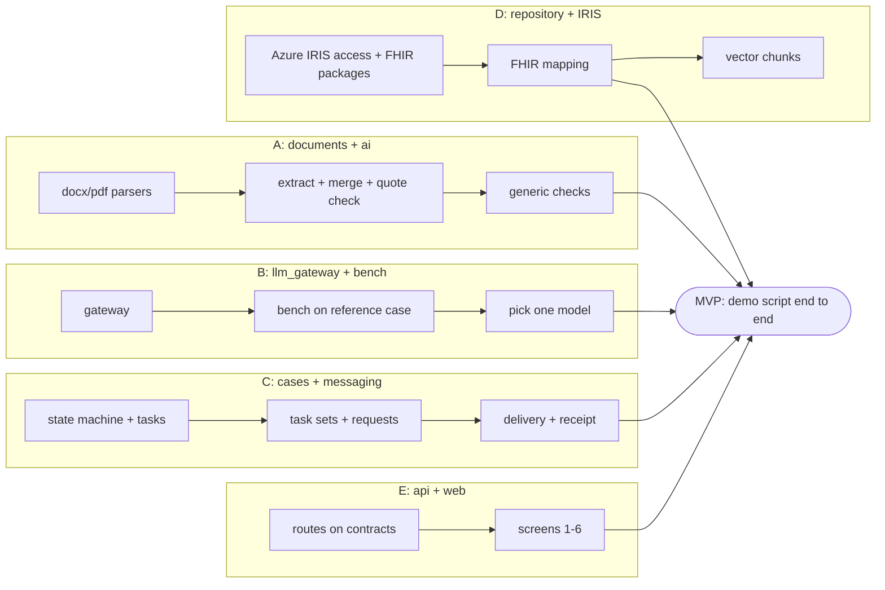

# Delivery plan

## Phase 0: foundation (first, unblocks everyone)
- [x] Source data extracted: [`data/vzp-structured`](../data/vzp-structured), via [`scripts/extract_sources.py`](../scripts/extract_sources.py)
- [x] Reference case: manifest, expected handover, expected findings ([reference-case.md](reference-case.md))
- [x] `contracts` package + tests
- [x] uv workspace with module skeletons
- [ ] Every dev has an Azure IRIS connection string + FHIR endpoint in `.env`; `/metadata` → fhirVersion 4.0.1
- [ ] CZ/EU IG packages loaded into the FHIR server (dependency gaps first, see data-model.md)
- [x] FastAPI app serving the seeded reference case (local uvicorn)
- [ ] `IrisRepository` connects to Azure IRIS (`GET /health` → `"iris_configured": true` plus a real query)
- [x] Typed web client generated from the API's OpenAPI spec (`@hey-api/openapi-ts`), drift guarded by a test
- [x] `apps/web` scaffold (Vite + React + TS), placeholder kanban fed by `/cases`
- [ ] `.env` with at least one working model endpoint

## Phase 1: MVP slice (the reference case end to end)

Each stream works against the in-memory fake until `IrisRepository` lands.

**Exit criterion:** the [demo script](demo-script.md) runs end to end for the reference case.

| Stream | Owner | Delivers |
|---|---|---|
| A: documents + ai | _tbd_ | Parsers, extraction to `Handover` with verbatim quotes, quote verification, merge, deterministic checks |
| B: llm_gateway + bench | _tbd_ | Gateway for our OpenAI-compatible endpoints; leaderboard of the 10–11 candidates on **both** reference cases → pick **one** model (Q-M1); **second synthetic reference case** with another diagnosis (Q-M4) |
| C: cases + messaging | _tbd_ | State machine, queue + manual on-hold, owner/due, tasks with dependencies, task sets editable in the UI, time to treatment, in-app notifications, requests, delivery + receipt, simulated patient notices, audit |
| D: repository + IRIS | _tbd_ | Azure IRIS access, FHIR IG packages, mapping per [data-model.md](data-model.md), in-memory fake |
| E: api + web | _tbd_ | FastAPI routes, screens 1–6 from [product.md](product.md) incl. the GP inbox for KOC requests and soft "fill in if you know" prompts, Czech + English UI (Q-F20) |

Integration rules:
- Change `contracts` first, in its own PR.
- Every module ships with tests against the in-memory fake.
- `main` always runs the demo.

## Phase 2: extensions (priority order, each behind an existing interface)
1. **Repeated MDT rounds** if Q-F8 is answered "yes".
2. **Vector search evidence + "ask the case":** IRIS `VECTOR` (InterSystems: GenAI + vector search).
3. **Coordinator copilot agent:** tools for FHIR search, vector search, create task, draft request (InterSystems: agents).
4. **Deadline notifications:** email/SMS channel adapters.
5. **Reviewing-doctor feed** (the patient's insurer, Q-F10).
6. **Embedded Python:** move hot paths into IRIS (Q-I1).
7. **Image/scan parser** through a vision model.
8. **IRIS Interoperability production trace** for intake → extract → store (a visual showcase).
