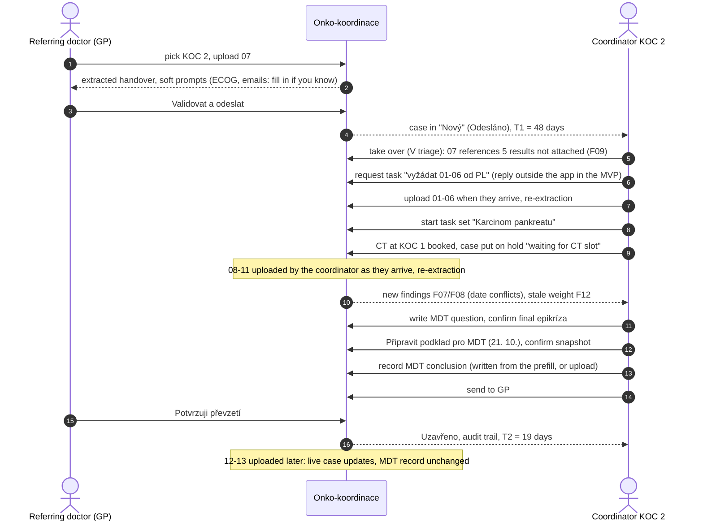

# Demo script

This runs the reference case end to end, roughly 5–7 minutes. It covers every item on the VZP checklist (slide 12) and shows the IRIS features the InterSystems challenge scores.
- **Users:** the referring doctor (GP) and the coordinator, switched with the role switcher in the header (Q-F21, Q-I11).
- **Hosting:** the demo runs deployed in Azure (Q-I8).
- **Language:** the UI can switch between Czech and English (Q-F20).

## Steps

| # | Role | Action | What to point at | Checklist |
|---|---|---|---|---|
| 1 | GP | Pick **KOC 2 Nemocnice Lipová**, drag in report 07 | No form: patient details, contacts and suspected C25.0 are prefilled from the document, each with a source | Referral without an extra form |
| 2 | GP | Review the handover. Soft prompts for missing ECOG (F01) and emails (F02, F03): "fill in if you know". Skip them → *Validovat a odeslat* | The GP owns the handover, gaps never block sending. Provenance: AI proposal → validated by the referring doctor | AI extraction with completeness check |
| 3 | Coordinator | The dashboard shows the case in **Nový** with T1 = 48 days (onset mid-August → referral 2. 10.) → take it over | State, owner, due date, time to treatment on the card | Overview with state and due date |
| 4 | Coordinator | Finding F09: "07 lists 5 examinations without results" → *Vyžádat* creates a request task addressed to whoever holds them (here the GP) | Request task with an owner and a due date | Completeness check |
| 5 | Coordinator | The reports "arrive" (outside the app in the MVP) → upload 01–06 → re-extraction fills the labs, imaging, weight 65 kg, height 165 cm | F09 resolved. In Phase 2 the GP would answer from their inbox (Q-F23) | |
| 6 | Coordinator | *Spustit sadu úkolů* "Karcinom pankreatu": CT at KOC 1, EUS-FNB, histology, labs, MDT, pain clinic, psychologist. *(Bonus, if built: accept an AI-proposed task from the referral's asks)* | Dependencies, owner per task, due dates | Owner of every next step |
| 7 | Coordinator | *Odložit* (put on hold): "čeká na termín CT v KOC 1" → card moves to **Odložený**; resume when booked | Manual on-hold flag with a reason | |
| 8 | Coordinator | Upload 08–11 as they "arrive" | Histology fills the diagnosis; new findings **F07/F08** (date conflicts in 09 and 11) → *Vyžádat* creates clarification request tasks; **F12** stale weight | |
| 9 | Coordinator | Write the MDT question (AI prefill); pick the final epikríza (GP's verbatim text vs AI summary side by side) | Nothing is invented; ECOG stays visibly missing, overridden with a note; C25.0 stays provisional (F05) | |
| 10 | Coordinator | *Informovat pacienta* about the MDT date | Recorded as sent, not actually delivered | |
| 11 | Coordinator | *Připravit podklad pro MDT* (21. 10.) → confirm snapshot. From the `reference_at_mdt` reset the case is *Kompletní*: the first try is refused until F01 is overridden (Q-F40) | MDT record in the `MDT_zapis` layout, members from the GIT board roster | MDT record |
| 12 | Coordinator | After the MDT, record the conclusion + recommendations (type them in from the meeting, starting from the prefill of diagnosis, date, place and copy, or upload the MDT's report) and the definitive MKN-10 code from it; confirming writes the code into the handover, then resolve F05 | Structured conclusion in the `MDT_zaver` layout | Structured KOC/MDT conclusion |
| 13 | Coordinator | Send to the GP | Result + original context attached | Feedback |
| 14 | GP | In-app inbox (MDT results) → *Potvrzuji převzetí* | Receipt in the audit → **Uzavřeno**; T2 = 19 days | Confirmed delivery |
| 15 | Coordinator | Upload 12–13 (after the MDT) | The live case updates, the MDT record does not | Brief rule: only what was known on 21. 10. |
| 16 | (InterSystems) | Show the FHIR server: `Patient` with the RČ identifier, `Provenance` of AI values and confirmations, the MDT conclusion `Bundle` and the request `Task`s, `Patient/$everything` for the whole case, and a `$validate` against the CZ profile (S9). "Ask the case" and an MKN-10 code suggestion via IRIS vector search (S8). Claude Desktop connected to `/mcp` asks which cases are overdue and what's missing (S10) | Interop + GenAI + agents on IRIS | IRIS criteria |
