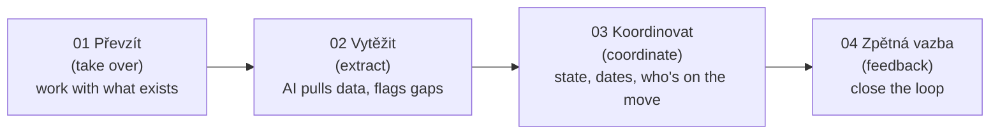
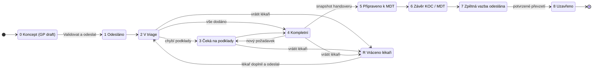
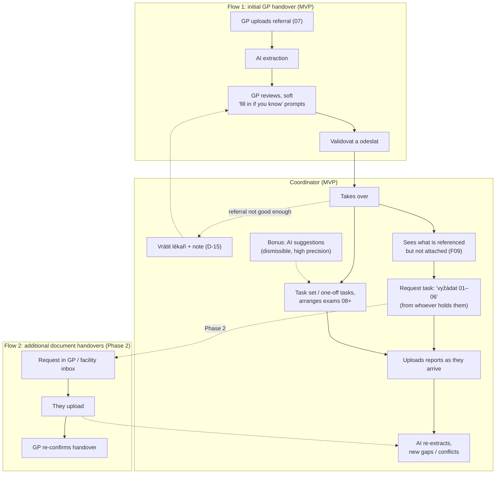

# Product: Onko-koordinace

A working tool for the **KOC coordinator** and the **referring doctor**. It takes one oncology case from referral to confirmed feedback without losing information. Everything is done in the UI: no configs, no code, no long forms.

Sources:
- the challenge brief: [Zadani_ulohy](../data/vzp-structured/brief/Zadani_ulohy.md)
- the VZP slides: [VZP_prezentace](../data/vzp-structured/brief/VZP_prezentace.md)
- the handover fields: [Handover_obsah](../data/vzp-structured/brief/Handover_obsah.md)
- the MDT record template: [MDT_zapis](../data/vzp-structured/brief/MDT_zapis.md)
- the sample MDT conclusion: [MDT zaver](../data/vzp-structured/brief/MDT%20zaver.md)

## The problem: information gets lost in three places

| Where | What goes wrong today | What we fix |
|---|---|---|
| **Na vstupu** (at intake) | Documentation arrives fragmented, over many channels, often incomplete. Doctors retype data that already exists | One digital entry point: upload the reports and AI prefills the rest |
| **Uvnitř KOC** (inside the KOC) | The coordinator chases documents instead of coordinating. Nobody has a shared view of state, dates or who is responsible. The MDT gets late or incomplete input | AI handover with gaps flagged, kanban with an owner and due date for every next step, a journey plan |
| **Na výstupu** (at output) | The referring doctor can't easily see whether the patient was accepted, what is missing, or what the MDT decided | A structured MDT result with the original context goes back, and delivery is confirmed |

Timing goal (slide 4): **time to treatment = T1 + T2 + T3**, shown on every case in the MVP (Q-F18):
- **T1:** symptom onset → referral to the KOC
- **T2:** referral → MDT
- **T3:** MDT → treatment start

The coordinator watches it.

Decisions behind this page are recorded in [open-questions.md](open-questions.md) (Q-…).

## Roles

There are **two users: the referring doctor and the KOC coordinator** (Q-F21).

| Role | Does in the app |
|---|---|
| **Referring doctor** (GP / specialist) | **Owns the handover** (Q-F22). Picks a KOC → uploads the referral (epikríza, plus whatever is at hand) → reviews the AI-extracted handover, with soft "fill in if you know" prompts for gaps → validates → sends. Fixes and resends a referral the coordinator returned with a note (D-15). In Phase 2 also answers KOC requests from an inbox (Q-F23). Receives the MDT result and confirms receipt |
| **KOC coordinator** | Works the queue. Takes over cases, or returns a referral to the GP with a note on what is missing (D-15). Sees the GP's original documents next to the structured handover. Coordinates everything after the referral: arranges examinations, requests and uploads their results, fills remaining gaps, starts task sets or adds one-off tasks, flags cases as on hold. Writes the MDT question and the final epikríza. Confirms the MDT snapshot. Records the MDT conclusion (writes it or uploads it). Sends it to the GP |

Not users, but present as information:
- **MDT doctors:** a roster per MDT board (Q-F13). They are recorded on the MDT record as members and signatories.
- **Reviewing doctor** (revizní lékař of the patient's insurer): an automatic feed is planned for Phase 2 (Q-F10).

## The four pillars (slide 6)

## Case states (slide 10)

At every moment it must be clear **where the case is, who is "na tahu" (on the move) and by when**.

| State | Meaning (from the slides) |
|---|---|
| Koncept (draft, ours, D-8) | The GP is preparing the referral; not visible on the KOC dashboard |
| Odesláno (sent) | The referring doctor sent the request and the available documents |
| V triage (in triage) | The case is accepted and checked; the documents get a first assessment |
| Vráceno lékaři (returned to the GP, ours, D-15) | The coordinator sent the referral back with a note on what is missing. The GP fixes the handover or adds documents and resends it; it returns to *V triage* with the same coordinator. Possible until the MDT snapshot |
| Čeká na podklady (waiting for documents) | Missing information was found and requested (in the MVP: open request tasks) |
| Kompletní (complete) | All required documents are in and prepared for the next step |
| Připraveno k MDT (ready for MDT) | The case is complete and handed to the KOC/MDT for expert review |
| Závěr KOC/MDT (KOC/MDT conclusion) | The expert team decided the next step and wrote recommendations |
| Zpětná vazba odeslána (feedback sent) | The result and recommendations went back in structured form |
| Uzavřeno (closed) | The case is closed and archived; the audit trail is kept |

Dashboard columns (slide 9):
- **Nový** (new): states 1–2, waiting to be taken over.
- **Aktivní** (active): everything else. A returned case stays here with the GP on the move.
- **Odložený** (on hold): a **manual flag** the coordinator sets with a reason and an optional resume date (Q-F9), e.g. "waiting for a CT slot at KOC 1".

## Screens (MVP)

S0 supplies the shared shell and identity selection before these screens (Q-W9). The referring doctor's temporary home shows identity, workplace and contacts only. The coordinator dashboard belongs to S1; its existing provisional read-only implementation is partial S1 work and is not counted toward S0 completion. Navigation contains only working destinations; the referral screen below arrives in S3, and the inbox in S6. Both roles can change language and open demo time/reset controls (Q-W10). S0 uses visibly labelled mock HTTP responses until the backend is implemented (Q-W6).

1. **Referral (GP portal), slide 7.**
   - Pick a KOC → drag and drop the referral (epikríza) plus any reports at hand.
   - AI extracts the handover: patient details, contacts, suspected diagnosis, referrer contact, and so on.
   - The GP reviews the extracted handover. Empty fields (e.g. ECOG, the patient's email) appear as **soft "fill in if you know" prompts** that never block sending (Q-F22).
   - *Validovat a odeslat* (validate and send).
   - Done when: the coordinator gets everything in one step.
   - **Returned referrals** (D-15): the GP sees the coordinator's note in the inbox, edits the handover or uploads documents, re-validates and resends.
   - *Phase 2 (Q-F23):* other KOC requests reach the GP's inbox; the GP uploads the reports and confirms the updated handover.
2. **Coordinator dashboard, slide 9.**
   - Kanban with Nový / Aktivní / Odložený (manual flag).
   - Each card shows patient, diagnosis, state, next step, owner, due date, priority/overdue, and time to treatment so far.
   - In-app notifications for upcoming and overdue tasks (Q-F17).
   - Done when: every patient shows their state, due date and who is on the move.
3. **Case detail.**
   - Tabs: *Přehled (overview) · Handover · Nálezy (findings) · Dokumenty (documents) · Úkoly/cesta (tasks/journey) · Komunikace (communication) · Audit*. The case opens on *Přehled*, which shows state, owner, next step, due date and time to treatment first.
   - Every handover value links to its source document with the quote highlighted.
   - **Dokumenty** lists every document of the case in one place. Each one opens as the **original file** and as its parsed text ("strukturovaná zpráva + originál", slide 9). The documents the GP handed over are marked as such (`uploaded_by`).
   - Gaps and conflicts have their own *Nálezy* tab (the tab shows how many are unresolved; in the handover, sections with a gap or conflict open first), each with **Vyžádat** (creates a request task addressed to whoever holds the information, linked to the finding; the reply comes outside the app in the MVP) or **Doplnit** (fill in manually, or upload, and AI re-extracts).
   - **Vrátit lékaři** (return to the GP, D-15): the coordinator writes what is missing, optionally pointing at a finding. The note goes to the GP's inbox and the case moves to *Vráceno lékaři*.
   - Every section is copy-ready (slide 8).
   - **Epikríza side by side** (Q-F15): the referring doctor's text verbatim next to the AI summary proposal; the coordinator writes or confirms the final version.
   - **MDT question**: written by the coordinator, optionally prefilled by AI (Q-F14).
   - Examinations list **everything** done (GP examinations too), each with all clinical sections verbatim (Q-C7, Q-C8).
   - *Odložit* (put on hold) with a reason and a resume date.
   - *Informovat pacienta* (inform the patient): composes a message (e.g. appointment details). It is recorded as sent but **not actually delivered** (Q-F16).
4. **Journey / tasks, slide 10.**
   - *Spustit sadu úkolů* (start a task set; for example the pancreatic-cancer set) or *Přidat úkol* (add a one-off task).
   - Each task has type, place, date, owner, status and dependencies (what must come first).
   - Task sets are created and edited **in the UI** by the coordinator (Q-F2, Q-F21).
   - In-app deadline notifications (Q-F17).
5. **MDT.**
   - *Připravit podklad pro MDT* (prepare MDT input) freezes a snapshot of the handover at the MDT date; the coordinator confirms it.
   - That produces the MDT record in the `MDT_zapis` layout: members from the board roster, diagnosis + MKN-10, comorbidities, results table.
   - After the meeting the coordinator **records the conclusion** and recommendations, either by writing them (an AI draft from the record is allowed) or by uploading the MDT's own report (Q-F12) → `MDT_zaver` document.
6. **Feedback, slide 11.**
   - Send to the referring doctor (result + original context). The reviewing-doctor feed comes in Phase 2.
   - The recipient clicks *Potvrzuji převzetí* (I confirm receipt) → the receipt goes into the audit → case closed.

## Where requests and tasks come from

Decided in Q-F1 to Q-F6, Q-F22 and Q-F23. There are **two handover flows**:

| Flow | What | Scope |
|---|---|---|
| **1. Initial GP handover** | The GP uploads the referral → AI extraction → the GP reviews with soft "fill in if you know" prompts → validates → sends | **MVP** |
| **2. Additional document handovers** | The KOC requests a report from whoever holds it (GP or facility) → the request appears in their inbox → they upload → re-extraction → the GP re-confirms the handover | **Phase 2** |

In the MVP, flow 2 is replaced by the coordinator: they log a request task and **upload** the report when it arrives through another channel (email, post, eZprávy). One exception is in the MVP: when the GP's referral itself is not good enough, the coordinator **returns it to the GP with a note** (D-15), and the GP fixes it and resends it through flow 1.

**The referring doctor owns the handover (Q-F22).** The GP sends the referral and validates the extracted handover; gaps are soft prompts that never block sending.

**The coordinator coordinates everything else (Q-F1).**
- After taking over, the coordinator sees what the referral mentions but doesn't include. In the reference case that's 07's five results (F09).
- They log a request to whoever holds each report (Q-F6): here the GP, otherwise the producing facility. In the MVP the reply comes outside the app and the coordinator uploads it (Q-F4, Q-F23).
- They start a **task set** they maintain in the UI (Q-F2) or add one-off tasks, arrange the KOC examinations (08 onwards) and upload their results. Each upload goes back through extraction.

**AI suggestions are a bonus, not the mechanism (Q-F1, Q-F3).**
- The AI may propose tasks or requests, e.g. from the referral's explicit asks ("CT, histologická verifikace").
- Proposals are dismissible and are shown only when they are specific and grounded in a quote. No suggestion is better than a nonsense one.
- The AI never creates tasks or sends requests on its own.

## Hard rules from the brief
- **AI only prepares a proposal, a human decides and confirms.** Every AI value is a proposal with a source until a person confirms it: the referring doctor for the handover, the coordinator for the MDT snapshot.
- **Don't infer.** Take data as written; whatever is missing gets flagged.
- **The MDT record contains only what was known at the MDT date.** This follows from the workflow: the snapshot is frozen at *Připraveno k MDT*, and later documents (the pain-clinic and psychology reports in the reference case) update the live case but never the frozen record.
- "Rakathon ověří princip, produkční integrace patří do další fáze" (Rakathon tests the principle; production integration is the next phase). Integrations may be simulated.

## Demo must show (slide 12)
- [ ] Referral to the KOC without an extra form (step 01)
- [ ] AI extraction with a completeness check (step 02)
- [ ] Case overview with state and due date (step 03)
- [ ] Owner of every next step (step 03)
- [ ] Structured KOC / MDT conclusion (step 04)
- [ ] Feedback and confirmed delivery (step 04)

Plus the deliverables from the brief: the MDT record generated by the app per `MDT_zapis`, and the MDT conclusion being sent to the GP. Walkthrough: [demo-script.md](demo-script.md).
