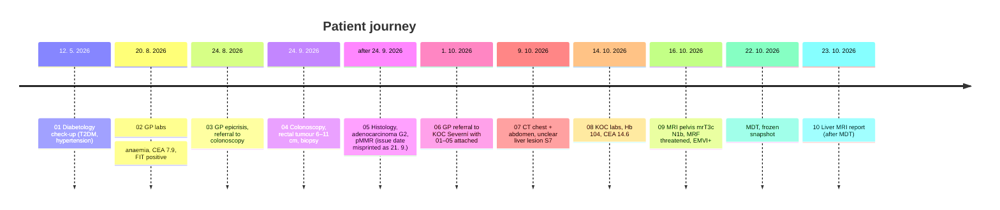

# Reference case 2: Miroslav Havlíček (synthetic)

A second test patient so that S2 extraction and checks are not tuned to [reference case 1](reference-case.md) (Q-M4: synthetic, another diagnosis). **Everything here is invented**, written by us rather than the challenge organisers. Like case 1 it is test data, not logic: the app must handle it with the same generic extraction and checks. Nothing in the code may name this patient, these documents or these dates.

| File | Contents |
|---|---|
| [`reference/manifest.json`](../data/reference-2/reference/manifest.json) | Metadata for all 10 reports. `received_at`: 01–06 on 1. 10. 2026 10:00 (the GP sends the referral **with** its attachments), 07–10 on their document dates |
| [`reference/expected_handover.json`](../data/reference-2/reference/expected_handover.json) | The correct handover **as of the MDT on 22. 10. 2026**, with verbatim evidence |
| [`reference/expected_findings.json`](../data/reference-2/reference/expected_findings.json) | The gaps and conflicts a good check should raise |
| [`reports/*.md`](../data/reference-2/reports) | The reports, written in the same Markdown style as case 1 (tables as Markdown) |
| [`originals/*.docx`](../data/reference-2/originals) | Word originals for upload tests, generated from the reports |

The originals are built from the Markdown, the reverse of case 1:

```bash
uv run python scripts/build_docx.py data/reference-2/reports data/reference-2/originals
```

[`scripts/build_docx.py`](../scripts/build_docx.py) uses only the stdlib. It writes one Word paragraph per Markdown block, real Word tables for the lab tables and bold all-caps headings, and the output is reproducible byte for byte. Edit the `.md`, then rerun the script and commit both.

Tests enforce the same rules as for case 1 ([`test_reference_case.py`](../packages/contracts/tests/test_reference_case.py), parametrised over both folders): the JSONs match the contracts, every quote and full-text field is verbatim, and no source arrived after `as_of`. [`test_reference_case_2.py`](../packages/documents/tests/test_reference_case_2.py) checks that `onko_documents.parse` turns each `.docx` back into its `.md`, ignoring the header line and whitespace.

## Story



## Actors
| Who | Role |
|---|---|
| MUDr. Jana Nováková | GP and referring doctor (Říčany, tel. +420 323 000 111, email in 06; `pl-novakova` in the directory) |
| MUDr. Hana Šindelářová | Diabetologist (Říčany) |
| MUDr. Pavel Vondráček | Gastroenterologist, colonoscopy (Gastroenterologie Říčany) |
| MUDr. Viktor Zeman | Pathologist (Patologie Praha-východ) |
| KOC Nemocnice Severní | The coordinating centre (`koc1-severni`): CT, MRI, labs, MDT |
| MUDr. Hana Vlčková | Clinical oncologist at KOC Severní, orders the staging |
| Mgr. Jitka Králová | KOC coordinator (`koord-severni`) |
| MDT pro nádory HPB | `mdt-hpb-severni`. The demo directory has no colorectal board outside KOC Lipová (used by case 1). The unclear liver lesion makes the HPB board, with its liver surgeon, a plausible place to discuss this case |
| Jana Havlíčková | The patient's wife and contact person; the patient consents to sharing (06) |

Patient: male, RČ 580314/2477 (10 digits, divisible by 11, born 14. 3. 1958, 68 years old), insurer 111 (VZP).

## Expected findings and the generic check that should catch them

| # | Finding | Generic check |
|---|---|---|
| F01 | Height missing in every document (needed for body-surface dosing); warning | required field missing |
| F02 | Allergy: the GP writes "AA: neguje" (03, 06), the diabetologist writes penicillin with a rash (01). The handover keeps `allergies` as `conflict` with no value and evidence from both sides | cross-document conflict (merge) |
| F03 | Diabetology (01) gives birth date 14. 3. **1956**, while its own RČ and every other document give 14. 3. 1958 | identity: RČ ↔ birth date |
| F04 | Histology is issued **21. 9.**, but its material is from the colonoscopy on **24. 9.** | temporal impossibility |
| F05 | The MRI of the pelvis (09) says the liver MRI is "a separate report", and the CT (07) asked for it to clarify the S7 lesion. It isn't attached by the MDT. It decides the M stage, so it's a blocker the coordinator can override | unattached reference |
| F06 | Hb 121 → 104 g/l, ferritin 18 → 9 µg/l, CEA 7.9 → 14.6 µg/l | trend |
| F07 | MDT members missing (outside the handover, S5; excluded from the S2 bench like case 1's F04) | required field missing (MDT_zapis) |
| F08 | Worsening iron-deficiency anaemia, no iron replacement documented | LLM clinical review (advisory) |

The mix is deliberately different from case 1. ECOG **is** present here (ECOG 1), the patient's and referrer's emails are present, the diagnosis code is confirmed, and there is a real value conflict and an identity mismatch, which case 1 has neither of.

**Things that look like problems but aren't (avoid false positives):**
- **ECOG 1 is stated** (06). Don't raise a missing performance status.
- **C20 is confirmed by histology.** The GP writes "histologicky verifikován" and 05 confirms adenocarcinoma, so the provisional-diagnosis check must not fire (unlike case 1's C25.0).
- **BMI 28.1 and weight 86 kg (01) give a height of about 175 cm.** Don't compute it: height stays missing (never infer).
- **Weight 86 → 85 → 84 kg** (May → August → October) is stable. No weight-loss trend, and the October weight is 3 weeks old at the MDT, so it isn't stale.
- **The lab prints "HAVLICEK MIROSLAV"** in capitals without diacritics (02). That is the same patient, not an identity mismatch.
- **The referral's PŘÍLOHY list (06) points to 01–05, which are attached.** No unattached reference there.
- **The pelvic MRI (09) is attached.** Only the liver MRI is missing; matching the reference against "any MRI" would hide F05.
- **The 4 mm lung nodule** is described as non-specific, and the **sigmoid polyp** is a tubular adenoma removed in one piece. Neither is a second tumour or a metastasis.
- **Metformin paused** around the colonoscopy (03, 04) and the contrast CT (07) is a usual instruction, not a medication change or conflict.
- **The liver MRI report (10)** is dated 23. 10. and received after the MDT (its hemangioma result is a second read). It must not go into the MDT handover, and F05 stays open at the snapshot.

## Values as of 22. 10. 2026 that are easy to get wrong
| Field | Correct | Trap |
|---|---|---|
| Height | **missing** | don't derive it from BMI |
| Weight | **84 kg** (1. 10., report 06) | 86 kg (01) and 85 kg (03) are older |
| Allergies | **conflict**: "neguje" (03, 06) vs penicillin (01) | the newest document does not simply win here; a human decides |
| Birth date | **14. 3. 1958** (RČ, 03, 06) | 1956 in 01 is a typo |
| ECOG | **ECOG 1** (06) | |
| Liver | lesion S7 **unclear** (07), liver MRI not attached | "hemangioma" comes from 10, after the MDT |
| Patient wishes | Avoid a permanent stoma if possible; consents to sharing with his wife (06) | |

## Examinations in the handover
All 6 examinations before the MDT, including the GP's own (Q-C7). Each `result_full_text` holds all clinical sections verbatim, without the administrative header and signature (Q-C8):

| Report | Sections included |
|---|---|
| 01 | DIAGNÓZY → ZÁVĚR A DOPORUČENÍ |
| 03 | EPIKRÍZA → DOPORUČENÍ (incl. ANAMNÉZA) |
| 04 | PŘÍPRAVA → DOPORUČENÍ |
| 06 | EPIKRÍZA + ANAMNÉZA |
| 07, 09 | POPIS → ZÁVĚR |

The diabetology report (01) quotes a few lab values in its text (HbA1c and others). They stay part of the examination text and are not a separate lab panel. Labs (02, with the FIT result, and 08) and histology (05) have their own fields. 06's PŘÍLOHY list is matched against the attached documents, and its ŽÁDOST is the source for the MDT question.
