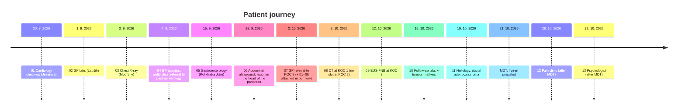

# Reference case: Alena Procházková (fictional)

This is the challenge's test patient. **It is test and demo data, not logic.** The app must find everything below by itself, using generic extraction and checks. The bench scores models against these files:

| File | Contents |
|---|---|
| [`reference/manifest.json`](../data/vzp-structured/reference/manifest.json) | Metadata for all 13 reports. `received_at`: 07 on 2. 10. 2026 14:00 (the real referral date), 01–06 on 2. 10. 16:00 (requested and supplied by the GP the same day; that time is simulated, Q-C10), 08–13 on their document dates |
| [`reference/expected_handover.json`](../data/vzp-structured/reference/expected_handover.json) | The correct handover **as of the MDT on 21. 10. 2026**, with verbatim evidence |
| [`reference/expected_findings.json`](../data/vzp-structured/reference/expected_findings.json) | The gaps and conflicts a good check should raise |
| [`reports/*.md`](../data/vzp-structured/reports) | Text of the reports (tables as Markdown) |

Tests in [`packages/contracts/tests`](../packages/contracts/tests/test_reference_case.py) enforce that:
- the JSONs conform to the contracts;
- every quote appears verbatim in its report;
- every full-text field (examination results, the GP's epikríza) is verbatim;
- no source in the handover came in after the MDT.

The organisers' answer key is the sample conclusion [MDT zaver](../data/vzp-structured/brief/MDT%20zaver.md).

## Story

## Actors
| Who | Role |
|---|---|
| MUDr. Tomáš Řezníček | GP and referring doctor (Dolní Břežany, tel. +420 311 000 287, no email) |
| MUDr. Ivana Křížová | Gastroenterologist (Poliklinika Jižní), indicated the CT |
| MUDr. Petr Malý | Cardiologist (Jesenice) |
| KOC 1 Nemocnice Severní | CT, pain clinic |
| KOC 2 Nemocnice Lipová | The coordinating centre: endoscopy, labs, pathology, psycho-oncology, MDT |
| Bc. Lucie Dvořáková | KOC coordinator |
| doc. MUDr. Pavel Hrubý, Ph.D. | Chairs the MDT for GI tumours |
| Petra Horká | The patient's daughter and contact person; the patient consents to sharing (07) |

## Who does what

**In the brief:** the GP sends 07 alone (it **lists** results without attaching them), and the coordinator requests 01–06.

**In our flow (Q-F6, Q-F22):** the GP sends 07 and validates the extracted handover; gaps are only soft prompts. The coordinator takes over, sees that 07 references 5 results that aren't attached (F09), and requests each report from whoever holds it. Here that's the GP, who ordered 02–04, was copied on 01 and 05, and knows the UZ result. The GP uploads 01–06 and confirms the updated handover.

Then the coordinator:
1. Starts the task set.
2. Books the **CT at KOC 1** because KOC 2 had no slot → 08.
3. Before the MDT, arranges the **biopsy and follow-up labs** → 09–11.
4. Books the **pain clinic and the clinical psychologist**. Both happen after the MDT → 12–13, which **do not** go into the MDT record.

## Expected findings and the generic check that should catch them

| # | Finding | Generic check |
|---|---|---|
| F01 | ECOG/Karnofsky missing, only "soběstačná" (self-sufficient); blocker the coordinator can override | required field missing |
| F02 | Patient email missing | required field missing |
| F03 | Referring doctor email missing (only a phone) | required field missing (MDT_zapis) |
| F04 | MDT members missing | required field missing (MDT_zapis); filled from the board roster |
| F05 | MKN-10 C25.0 only *suspected* by the GP; histology gives MKN-O 8500/3 | provisional vs confirmed diagnosis |
| F06 | Cholestasis persists, biliary drainage not documented | LLM clinical review (advisory) |
| F07 | EUS-FNB on **12. 10.**, but the "last apixaban dose" is on **18. 10.** | temporal impossibility |
| F08 | Histology: sample taken **20. 10.**, issued **19. 10.**, procedure on 12. 10. | temporal impossibility |
| F09 | The referral lists 5 examinations without results; the coordinator requests them from whoever holds them (here the GP), resolved when 01–06 arrive | unattached reference |
| F10 | Weight 69 → 65 kg | trend |
| F11 | Bilirubin 38 → 23, CRP 86 → 18, Hb 124 → 118 | trend |
| F12 | Last weight is from 15. 9., 5 weeks before the MDT, while the patient is losing weight | stale value (Q-C6) |

**Things that look like problems but aren't (avoid false positives):**
- The CT was indicated by MUDr. Křížová although the coordinator booked it. That is normal.
- 3 needle passes vs 4 tissue cores. One pass can yield several cores.
- The pain-clinic weight of 63 kg, tramadol, HADS score, the diagnosis being told to the patient on 23. 10., and the daughter-involvement wish in 13 are **after the MDT**. They aren't errors; they just don't belong in the MDT record.
- The insurer code 211 (= ZPMV, not VZP) and RČ 635722 ↔ 22. 7. 1963, female, 63 years are consistent. The identity check passes.

## Values as of 21. 10. 2026 that are easy to get wrong
| Field | Correct | Trap |
|---|---|---|
| Weight | **65 kg** (15. 9., report 05) | 63 kg is from report 12, after the MDT; 69 kg is older |
| Height | **165 cm** (01, the only source) | |
| ECOG | **missing** | don't infer it from "soběstačná" |
| Medication | 07 FA list; apixaban paused for the EUS, restart 21. 10. | tramadol/metamizol from 12 come after the MDT |
| Patient wishes | Consents to sharing with the daughter (07) | the wish in 13 comes after the MDT |

## Examinations in the handover
All 8 examinations before the MDT are listed (Q-C7), including the GP's own: 01 cardiology, 04 GP (1. 9.), 03 X-ray, 05 gastroenterology, 06 UZ, 07 GP (2. 10.), 08 CT, 09 EUS-FNB. Each `result_full_text` holds all clinical sections verbatim (findings, ZÁVĚR, DOPORUČENÍ) without the header and signature (Q-C8). Labs (02, 10) and histology (11) have their own fields.
