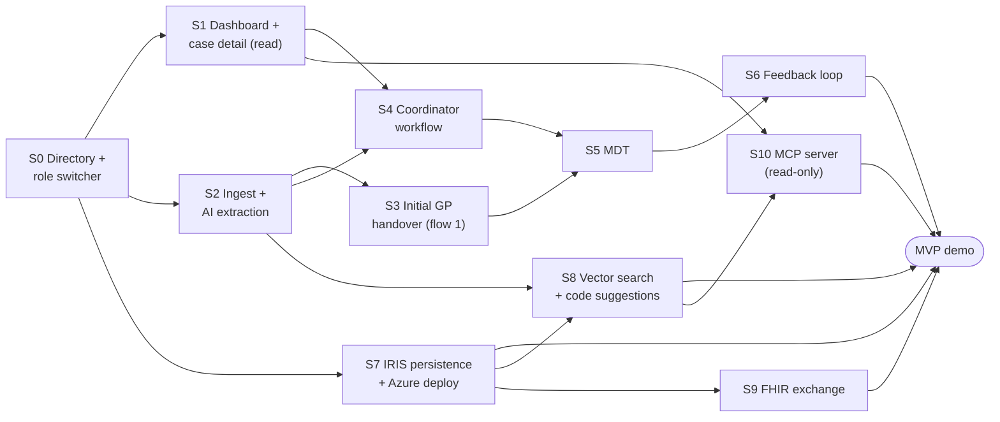

# Vertical slices and build order

Each slice is a **demoable piece of the product, end to end**: UI screen, API endpoints ([api.md](api.md)), module logic and tests. A slice is done when its demo steps ([demo-script.md](demo-script.md)) work on the reference case.

- **Ownership:** one dev (or pair) owns a slice across all layers. Module owners ([architecture.md](architecture.md)) review changes to their module.
- **Contracts first:** a slice that needs a contract change lands it in its own PR first.

## Order

- **Critical path:** S0 → S2 → S3 → S5 → S6. S2 is the riskiest slice (AI quality, model choice), so it starts on day one.
- **In parallel from the start:** S1 (frontend on the seeded data, which works today) and S7 (behind the repository port).
- **InterSystems features (Q-I17):** S8, S9 and S10 are MVP slices, built next to the critical path once S2 and S7 land. They need new contract models and endpoints first (a contract PR, then api.md).

| # | Slice | Depends on | Can start |
|---|---|---|---|
| S0 | Directory + role switcher | none | now |
| S1 | Dashboard + case detail (read) | S0 | now (endpoints already work on seeded data) |
| S2 | Document ingest + AI extraction | S0 | now |
| S7 | IRIS persistence + Azure deploy | S0 | now |
| S3 | Initial GP handover (flow 1) | S2 for real extraction; UI can start on the seed | after S0 |
| S4 | Coordinator workflow | S1, S2 | after S1 |
| S5 | MDT | S3, S4 | after S4 |
| S6 | Feedback loop | S5 | after S5 |
| S8 | Vector search + MKN-10 code suggestions | S2, S7; an embedding model (Q-M7) | after S2 and S7 |
| S9 | FHIR exchange in and out | S7; the MDT Bundle needs S5, request tasks need S4, referral intake needs S3 | after S7 |
| S10 | Read-only MCP server | S1 (read endpoints); "ask the case" needs S8 | after S1 |

## S0: Directory + role switcher
**Agreed delivery for S0 (Q-W1–Q-W12): frontend foundation with MSW dummy HTTP responses; no backend implementation in this slice.** Mantine, TanStack Router and i18next provide the shared UI. All screens still consume the existing generated API helpers. Real directory persistence and clock/reset endpoints below remain backend work; S0 does not mark those stubs implemented.

- **Goal:** the app knows who is using it and which KOCs, people and MDT boards exist.
- **Endpoints:** `me`, `listOrganizations`, `listActors`, `listMdtBoards`, `getMdtBoard`, plus demo support `getDemoClock`, `setDemoClock`, `resetDemo`.
- **UI:**
  - Header role/person switcher from the directory that sets `X-Actor-Id` (reference pair: GP `pl-reznicek` / coordinator `koordinator`).
  - Czech/English UI switch (Q-F20).
  - App shell and routing.
- **Modules:**
  - Load the demo directory from [`data/demo/directory.json`](../data/demo/directory.json): 5 KOCs with a coordinator each, 5 referring doctors, report specialists, 5 MDT boards (the GIT board matches `MDT zaver`), all insurers.
  - Repository methods for the directory.
  - App clock used for every "now".
  - Reset scenarios `empty` and `reference_at_mdt`.
- **Frontend done when:** all ten user identities can be selected and verified through simulated `/me`; the shell, role-based routing, Czech/English switching, continuously running demo clock and both confirmed reset scenarios work without a backend, including from the built web. Reloading returns to a Czech identity picker and the reference scenario. Behavior and implemented-response contract checks, build and lint pass. The dashboard is not an S0 acceptance criterion. See [apps/web/README.md](../apps/web/README.md).
- **Backend follow-up:** implement the directory, repository methods, app clock and reset endpoints listed above; retain their existing contracts. Until then real API mode shows actual API errors, including 501.

## S1: Coordinator dashboard + case detail (read-only)
- **Current status:** a provisional KOC-filtered read-only kanban already exists. Its appearance, directory name resolution and language support were updated while preparing the shared shell. This is partial S1 work, not part of the S0 completion criteria; case detail, evidence navigation and time-to-treatment remain unfinished.
- **Goal:** slide 9. Every case shows its state, due date and who is on the move.
- **Endpoints (already working on the seed):** `listCases`, `getCase`, `getHandover`, `listFindings`, `listTasks`, `listDocuments`, `documentText`, plus `getTimeToTreatment`. New here: `getDocumentFile`, so the coordinator opens the original of every document (slide 9: "strukturovaná zpráva + originál"). The seed stores the original `.docx` bytes from `data/cesta-pacienta-data/Pacient/`.
- **UI:**
  - Kanban Nový / Aktivní / Odložený with cards showing patient, diagnosis, state, next step, owner, due date and time to treatment.
  - Case detail tabs: Handover with click-through to the highlighted quote in the source document, Dokumenty (every document in one place, each opening as the original file and as text, the GP's ones marked), Findings panel, Úkoly.
- **Done when:** demo steps 3 and 5 can be shown read-only on the seeded case, and every seeded document opens as its original.

## S2: Document ingest + AI extraction
- **Goal:** pillar 02. Uploaded reports turn into a handover with verbatim evidence, plus findings.
- **Endpoints:** `uploadDocument` (with `received_at`), `getJob`, `listCaseJobs`, `updateDocument` (correct AI metadata), `reextractCase`.
- **Modules:**
  - `documents`: parse; duplicate check on upload, a warning only: SHA-256 for exact copies, word-shingle overlap for near copies (Q-I22).
  - `ai`: extraction (map per document, then merge), quote verification, AI document metadata, generic checks.
  - **Normalization (Q-C13):** text normalized before the quote check (offsets stay in the original); RČ, phone, email and insurer code in canonical form; weight/height in kg/cm; lab values with a parsed number, comparator and UCUM unit, and performance status as scale + score. The last two are a contract change in its own PR. A value that can't be normalized keeps its raw form and raises a finding.
  - `llm_gateway`: the model client.
  - `bench`: compare the candidates and **pick one model** (Q-M1).
  - **Second synthetic reference case** (Q-M4; a separate session is proposed for it).
- **Done when:**
  - Uploading 01–11 into an empty case reproduces `expected_handover.json` and F01–F12 within an agreed bench score.
  - The same holds on reference case 2.
  - The model is chosen.

## S3: Initial GP handover (flow 1)
- **Goal:** slide 7 + Q-F22. Referral without a form; the GP owns and validates the handover.
- **Endpoints:** `createReferral`, `uploadDocument` (from S2), `getJob`, `updateHandoverField`, `addExamination`, `validateHandover`, `sendReferral`.
- **UI (GP portal):**
  - KOC picker, drag-and-drop upload, job progress.
  - Handover review with sources.
  - Soft "fill in if you know" prompts, with *Doplnit* / *Není k dispozici*.
  - *Validovat a odeslat*.
  - **Returned referrals** (D-15): the coordinator's note (from `listInbox`), editing and uploading while the case is `vraceno_lekari`, then resending (`sendReferral`: `vraceno_lekari → v_triage`).
- **Done when:** demo steps 1–2; the case appears in the coordinator's **Nový** column. A returned case can be fixed and resent, and it comes back in *V triage*.

## S4: Coordinator workflow
- **Goal:** pillar 03. Coordinate everything after the referral.
- **Endpoints:**
  - case: `takeOverCase`, `updateCase` (priority, coordinator, planned MDT), `transitionCase`, `returnCase`, `setHold`, `clearHold`, `updateMilestones`, `listAudit`
  - findings: `resolveFinding`, `requestFromFinding`
  - tasks: `createTask`, `updateTask`, `startTaskSet`, `listTaskSets`, `createTaskSet`, `updateTaskSet`, `listNotifications`
- **UI:**
  - *Převzít* (take over, V triage), case and task priorities.
  - *Vrátit lékaři* (D-15): return the referral to the GP with a note, optionally linked to a finding.
  - *Vyžádat* (request task) and *Doplnit* on findings; override with a note (e.g. ECOG).
  - Task list and task-set editor, *Spustit sadu úkolů*, *Odložit*.
  - Coordinator upload of arriving reports (reuses S2).
  - In-app notifications, audit tab (backed by the append-only `app_audit` table, Q-I26).
- **Done when:** demo steps 3–8.

## S5: MDT
- **Goal:** the MDT record (deliverable) and the structured conclusion.
- **Endpoints:**
  - drafts: `createDraft` (`epicrisis_summary`, `mdt_question`, `mdt_results`, `mdt_conclusion`)
  - record: `createMdtSnapshot`, `getMdtRecord`, `updateMdtRecord`, `getMdtRecordPdf`, `updateMdtBoardMembers`
  - conclusion: `upsertMdtConclusion`, `uploadMdtConclusion`, `getMdtConclusion`, `confirmMdtConclusion`, `getMdtConclusionPdf`
- **UI:**
  - Epikríza side by side (verbatim vs AI summary) and the MDT question editor.
  - *Připravit podklad pro MDT*, blocked with 409 until blockers are resolved or overridden.
  - MDT record view/PDF; conclusion editor or upload; definitive MKN-10.
- **Modules:** `documents.render_pdf` (MDT_zapis / MDT_zaver layouts).
- **Done when:** demo steps 9, 11, 12. The MDT record matches the `MDT_zapis` layout, and the snapshot excludes reports received after 21. 10.

## S6: Feedback loop
- **Goal:** pillar 04. Close the loop with confirmed delivery.
- **Endpoints:** `sendFeedback`, `listInbox`, `confirmReceipt`, `listCaseReceipts` (proof of delivery), `listCaseMessages`, `createPatientNotice`.
- **Modules:** `repository`: `app_message_recipient` so `listInbox` is an indexed lookup by recipient (Q-I26).
- **UI:**
  - *Odeslat PL* (send to the GP).
  - The GP's inbox with the result + original context and *Potvrzuji převzetí*.
  - *Informovat pacienta* (simulated).
  - Case closes (Uzavřeno); T2 is shown.
- **Done when:** demo steps 10, 13–15, and the whole demo runs end to end.

## S7: IRIS persistence + Azure deploy
- **Goal:** the data lives in IRIS. Demo on Azure (Q-I8), and the InterSystems showcase.
- **Modules:** `IrisRepository` behind the `CaseRepository` port:
  - **App state** in IRIS SQL tables generated from the contracts; the handover as one JSON document (Q-I14).
  - **FHIR projection** of the showcase resources (Patient with the RČ identifier, Condition, DiagnosticReport/Observation, Composition, Provenance) per [data-model.md](data-model.md).
  - IG packages (Q-I6).
  - Foreign keys on `case_id` / `document_id` and bitmap indexes on filter columns (Q-I26, Q-I27).
  - Deployment of API + web to Azure.
- **Done when:** the API runs with `IrisRepository` and passes the same tests as the in-memory fake; demo step 16; the demo runs from Azure.

## S8: Vector search + MKN-10 code suggestions
- **Goal:** InterSystems criterion GenAI + vector search, used inside the evidence model (Q-I19), not as a side feature.
- **Endpoints:** new ones for "ask the case" and code candidates, added to api.md by a contract PR first (new models: document chunk, answer with quotes, code candidate).
- **Modules:**
  - `repository`: the `doc_chunk` table with a `VECTOR` column, filtered by `case_id` with an exact scan, no approximate index ([data-model.md](data-model.md) › Non-FHIR storage); the MKN-10 code table with embeddings (Q-C12).
  - `ai`: chunk every parsed document along its sections (document id + character offsets) and embed it; a quote not found verbatim is flagged and shown with the nearest chunk (D-2 unchanged); "ask the case" retrieves the top chunks, answers only with quotes and checks each verbatim, else "not found" (no similarity cut-off); MKN-10 candidates.
  - `llm_gateway`: `embed` on the EU Data Zone embedding model (Q-M6, Q-M7).
- **UI:**
  - "Ask the case" in case detail, every answer with click-through quotes.
  - On a diagnosis without a code: the top MKN-10 candidates labelled as AI; the pick is stored as `origin=manual` and the AI suggestion is kept in the audit log until the contract records it (Q-C11, Q-I21).
- **Done when:** demo step 16 shows "ask the case" and a code suggestion on the reference case, and the same works on reference case 2.

## S9: FHIR exchange in and out
- **Goal:** InterSystems criterion interoperability. The IRIS FHIR server is the exchange surface, not only storage (Q-I20). FHIR REST only, no ObjectScript (Q-I18).
- **Modules:** `repository` (projection, outbox), `api` (referral intake). New resources are added to [data-model.md](data-model.md) first.
- **Scope:**
  - **MDT conclusion out:** when the conclusion is sent (S6), a FHIR document `Bundle` (`Composition` first, then only the resources it references; unique identifier and timestamp; never changed, a correction is a new Bundle) plus a `DocumentReference` indexing it, with the Bundle and the PDF as attachments (Q-I20).
  - **Audit out:** `app_audit` rows projected as FHIR `AuditEvent` (Q-I26).
  - **`$validate` (Q-I25):** the opt-in IRIS tests validate every projected resource on the server against its declared profile.
  - **`Patient/$everything` (Q-I25):** the whole case as one Bundle, read straight from the IRIS FHIR server, not through the API.
  - **Outbox (D-14):** every FHIR write is stored in the same IRIS SQL transaction as the app-state save and retried until it succeeds; pending writes are visible.
  - **Tasks out:** every `Task`, including request tasks, projected as FHIR `Task` (requester = KOC, owner = whoever holds the report).
  - **Referral in:** a referral accepted as a FHIR `Bundle` next to file upload; attached documents go through extraction (S2). How structured values enter the handover is open (Q-I21, a contract change).
- **Done when:** demo step 16 reads the MDT Bundle and the request `Task`s from the FHIR server, `Patient/$everything` returns the whole reference case, the IRIS tests pass `$validate` for every projected resource, a referral Bundle creates a case in **Nový**, and a FHIR write that fails once is retried from the outbox.

## S10: Read-only MCP server
- **Goal:** InterSystems criterion agents. Any agent can read KOC data through MCP (Q-I23).
- **Where:** inside `apps/api`, mounted under `/mcp` (streamable HTTP), no new module. Library: Q-I24.
- **Tools** (read-only, the same services and contract models as the REST endpoints, same `X-Actor-Id` role check):
  - case search (by KOC, state, queue, overdue)
  - case summary: state, who is on the move, next step, due date, time to treatment
  - findings of a case
  - handover with sources (values with their quotes)
  - "ask the case" (from S8)
- **Not included:** write tools (AI proposes, a human confirms), FHIR tools (agents read the IRIS FHIR server directly).
- **Done when:** demo step 16: Claude Desktop connected to the deployed `/mcp` answers "which cases at KOC 2 are overdue and what's missing?" with quotes; tests call every tool against the in-memory fake.

## After the MVP (Phase 2)
Bonus AI task suggestions (`suggestTasks`), then the Phase 2 list in [delivery.md](delivery.md): additional document handovers (flow 2), repeated MDT, and the rest.

## Notes for slice owners
- The seed puts the reference case at *Připraveno k MDT*. S3–S6 start from `resetDemo {scenario: empty}`. Frontend S0 simulates this operation; its actual backend implementation remains a follow-up (Q-W6).
- Every slice turns its stubs into real endpoints and keeps the response models unchanged. If a response model must change, change the contract first, then run `uv run python scripts/export_openapi.py` and `npm --prefix apps/web run gen:api`.
